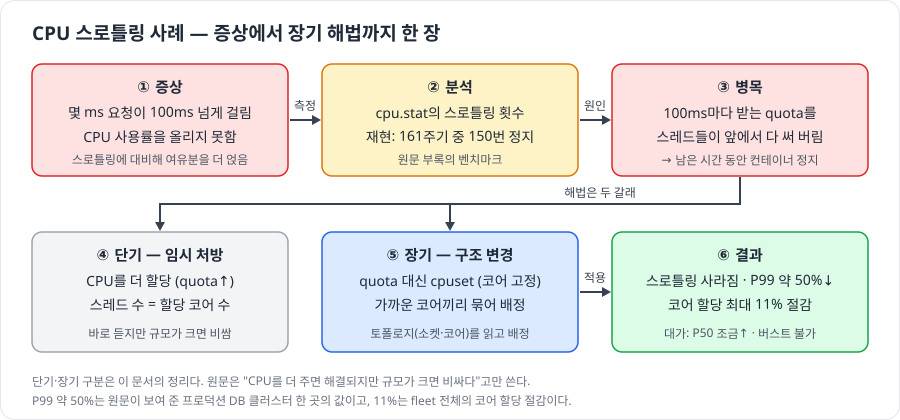
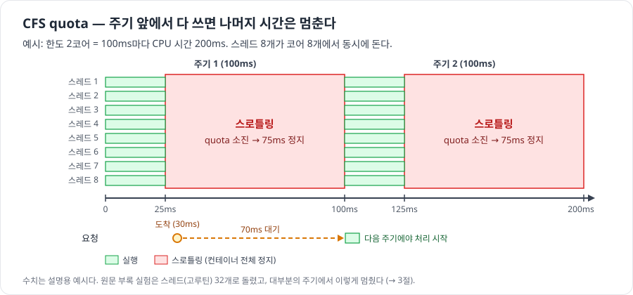
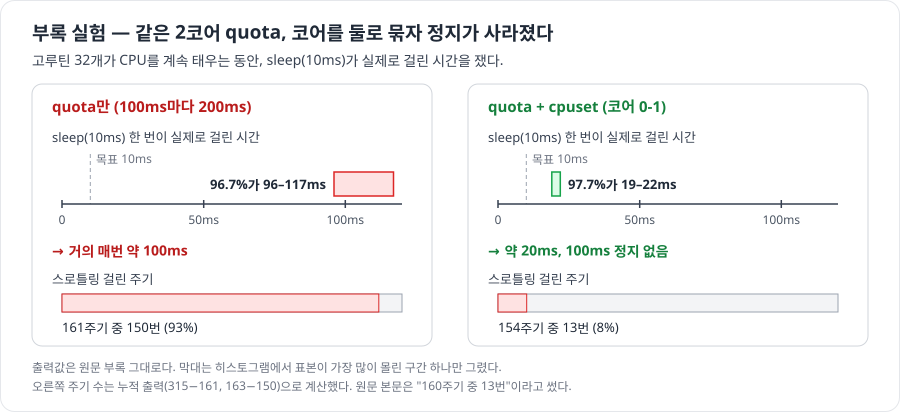
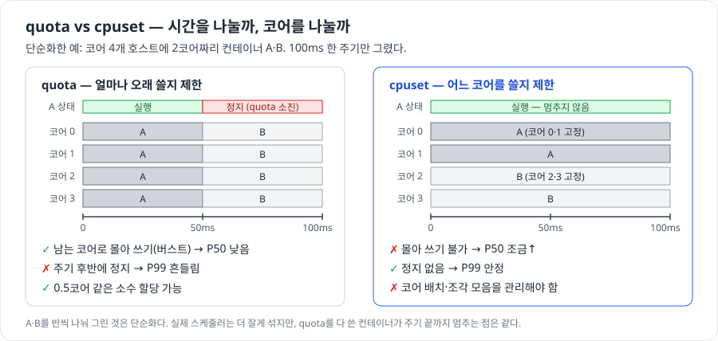
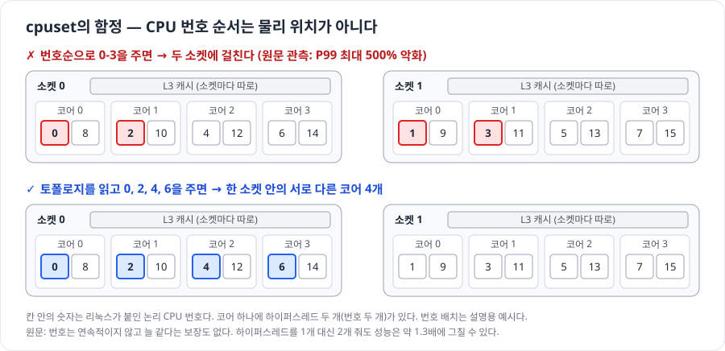

# 서버(OS) 성능 병목 분석과 최적화 - CPU 스로틀링이 P99를 늘리는 이유와 단기·장기 해법

## 출처

- **아티클**: Avoiding CPU Throttling in a Containerized Environment
- **저자/출처**: Joakim Recht, Yury Vostrikov, Uber Engineering 블로그, 2022-03-22
- **링크**: https://www.uber.com/blog/avoiding-cpu-throttling-in-a-containerized-environment/
- **부록**: [Appendix: testing quotas and cpusets](https://gist.github.com/ubermunck/2f116b7817812ae6255d19a4e10242f4). 원문 본문이 링크한 테스트 상세다. 원문의 일부로 보고 3절에서 다룬다.

> 원문에 없는 내용은 **(보충)**으로 표시했다. 보충 사실은 리눅스 커널 [cgroup v2 문서](https://docs.kernel.org/admin-guide/cgroup-v2.html), Kubernetes [CPU 관리 정책 문서](https://kubernetes.io/docs/tasks/administer-cluster/cpu-management-policies/), [Go 1.25 릴리스 노트](https://go.dev/doc/go1.25), util-linux [lscpu 매뉴얼](https://github.com/util-linux/util-linux/blob/master/sys-utils/lscpu.1.adoc)에서 가져왔다.
>
> 그림은 원문 내용을 바탕으로 직접 그린 것이다(`images/`). PoC는 만들지 않았고, 문서의 명령어도 직접 실행해 확인하지 않았다. 3절의 수치는 원문 부록에 실린 출력이다.

---

## AI 요약

> **CPU 스로틀링의 뜻**: 이 글에서는 **프로세스 묶음(cgroup)이 정해진 CPU 시간 예산(quota)을 다 쓰면, 커널이 다음 주기에 예산이 보충될 때까지 그 묶음의 CPU 실행을 일시적으로 제한하는 것**을 말한다.
>
> 쉽게 말해, “이번 주기에 쓸 CPU 시간을 다 썼으니 다음 예산이 들어올 때까지 기다려”라는 제한이다. 호스트에 놀고 있는 CPU가 있어도 발생할 수 있다.

### 0. 한 장 요약 — 왜 P99가 늘고, 무엇으로 고쳤나



<sub>quota: 100ms마다 컨테이너가 쓸 수 있는 CPU 시간 · cpuset: 컨테이너가 쓸 코어를 고정하는 기능 · P50 / P99: 중간 / 가장 느린 1% 요청의 응답 시간 · cpu.stat: cgroup의 CPU 통계 파일 · 버스트: 남는 코어로 몰아 쓰기 · 토폴로지: 소켓·코어의 물리 배치 (자세한 정의는 1·3·5절)</sub>

> **답**
> 1. **왜 늘었나**: 컨테이너는 100ms마다 정해진 CPU 시간(quota)만 받는다. 스레드가 많으면 이 시간을 주기 앞부분에 다 써 버리고, 주기가 끝날 때까지 멈춘다. 그 사이 들어온 요청은 다음 주기까지 기다린다.
> 2. **단기**: CPU를 더 주거나 스레드 수를 할당 코어 수에 맞춘다. 바로 듣지만 규모가 크면 비싸다.
> 3. **장기**: 시간 한도(quota) 대신 코어를 고정(cpuset)하고, 물리적으로 가까운 코어를 골라 준다. P99는 약 50% 줄고 코어 할당은 최대 11% 줄었다. 대가로 P50이 조금 오른다.

| 질문 | 한 줄 답 | 근거 |
| --- | --- | --- |
| 현재 인프라의 문제는? | 스로틀링에 대비해 CPU 여유분을 더 얹느라 사용률을 올릴 수 없었다 | 1절 |
| 병목은 어디인가? | 커널 스케줄러가 CPU 시간을 나눠 주는 방식(CFS quota) | 2절 |
| 어떻게 확인했나? | 재현 벤치마크와 `cpu.stat`의 스로틀링 횟수 | 3절 |
| 단기 해법은? | CPU 추가 할당, 스레드 수 조정 | 4절 |
| 장기 해법은? | cpuset 전환, 토폴로지를 읽고 코어 배정 | 4·5절 |
| 대가와 남은 과제는? | P50 소폭 상승, 버스트 불가, 코어 조각 모음 | 6절 |

### 1. 현재 인프라 — 무엇이 문제였나

Uber는 상태 저장(stateful) 워크로드를 모두 공용 컨테이너 플랫폼에서 돌린다. MySQL, Cassandra, Elasticsearch, Kafka, HDFS, Redis 등이 같은 물리 호스트에 함께 올라간다.

| 규모 | 값 |
| --- | --- |
| 물리 호스트 | 65,000대 |
| 코어 | 240만 개 |
| 컨테이너 | 20만 개 |

- **목표**: 사용률을 올려 비용을 줄이는 것.
- **막힌 지점**: CPU 스로틀링. 스로틀링은 "할당이 부족하다"는 신호로 읽혔고, 그래서 스파이크에 대비한 여유분(오버프로비저닝)을 얹어야 했다.
- **원인**: 리눅스 커널이 프로세스에 실행 시간을 나눠 주는 방식에 있었다.

| 용어 | 뜻 |
| --- | --- |
| cgroup | 프로세스 묶음의 자원 사용을 제한하는 커널 기능. 컨테이너 하나가 보통 cgroup 하나다 |
| CFS quota / period | 주기(period, 보통 100ms)마다 쓸 수 있는 CPU 시간(quota). `quota = 코어 수 × 주기` |
| 스로틀링 (throttling) | quota를 다 쓴 cgroup을 그 주기가 끝날 때까지 멈추는 것 |
| cpuset | cgroup이 실행될 코어를 고정하는 기능 (CPU pinning) |
| P50 / P99 | 응답 시간을 줄 세웠을 때 50%, 99% 위치의 값. P99를 꼬리 지연(tail latency)이라 부른다 |

> 스로틀링은 "CPU를 더 달라"는 신호처럼 보이지만, 원인은 CPU를 나눠 주는 방식이었다.

### 2. 병목 — 100ms 주기의 quota를 앞에서 다 써 버린다



- 2코어 컨테이너는 100ms마다 CPU 시간 200ms를 받는다.
- 컨테이너 안에 스레드·프로세스가 많으면 여러 코어에서 동시에 돌며 quota를 빠르게 쓴다. 다 쓰면 주기가 끝날 때까지 컨테이너 전체가 멈춘다.
- 평소 몇 ms면 끝나는 요청도 이 정지에 걸리면 100ms를 넘긴다. 지연에 민감한 서비스에 특히 문제다.

> 스레드가 많을수록 quota는 빨리 바닥나고, 남은 주기는 통째로 대기 시간이 된다.

### 3. 분석 — 재현하고 `cpu.stat`으로 확인한다



부록은 같은 2코어 quota에서 cpuset 유무만 바꿔 비교했다.

| 항목 | 값 |
| --- | --- |
| 한도 | quota 200ms / 주기 100ms (2코어 분량) |
| 부하 | CPU를 계속 태우는 고루틴 32개 (Go 프로그램) |
| 측정 | `sleep(10ms)`가 실제로 걸린 시간의 분포 |
| 비교 조건 | 같은 quota에 cpuset을 더해 코어 0·1번 두 개로 묶음 |

| 조건 | sleep(10ms) 실측 | 스로틀링 걸린 주기 |
| --- | --- | --- |
| quota만 | 96.7%가 96–117ms | 161주기 중 150번 (93%) |
| quota + cpuset (코어 0-1) | 97.7%가 19–22ms | 154주기 중 13번 (8%) |

- 스로틀링 횟수는 cgroup의 CPU 통계 파일 `cpu.stat`에 있다. `nr_periods`는 스케줄링 주기 수, `nr_throttled`는 그중 스로틀링된 주기 수다.
- 부록은 `GOMAXPROCS`(Go가 동시에 쓰는 OS 스레드 수)를 할당 코어 수에 맞추지 않으면 심하게 스로틀링된다고도 밝힌다.
- cpuset 조건에서도 10ms가 아니라 약 20ms가 걸린 것은 코어 2개를 고루틴 33개가 나눠 쓰기 때문으로 보인다. 스로틀링과는 다른 대기다. (내 해석)

> **동시에 도는 스레드 수를 할당 코어 수 이하로 묶으면 스로틀링이 사라진다.** cpuset은 코어를 묶어서, `GOMAXPROCS`는 스레드 수를 줄여서 같은 효과를 낸다. (내 해석)

<sub>표의 둘째 행 주기 수는 누적 출력(315−161, 163−150)으로 계산했다. 원문 본문은 "160주기 중 13번"이라고 썼다.</sub>

<details>
<summary>부록의 측정 명령 (cgroup v1)과 cgroup v2 대응</summary>

부록의 명령 (cgroup v1, `cgroup-tools` 패키지):

```bash
# quota: 100ms마다 200ms (2코어 분량)
cgcreate -g cpu,cpuacct:lat
echo 200000 > /sys/fs/cgroup/cpu/lat/cpu.cfs_quota_us
cgexec -g cpu,cpuacct:lat bash
./cgroup-lat                               # 고루틴 32개 + sleep(10ms) 지연 히스토그램
head -2 /sys/fs/cgroup/cpu/lat/cpu.stat    # nr_periods 161, nr_throttled 150

# 같은 셸을 코어 0-1, NUMA 노드 0에 묶는다
cgcreate -g cpuset:lat
echo 0-1 > /sys/fs/cgroup/cpuset/lat/cpuset.cpus
echo 0   > /sys/fs/cgroup/cpuset/lat/cpuset.mems
cgclassify -g cpuset:lat $$
./cgroup-lat                               # 97.7%가 19–22ms
```

(보충) 요즘 배포판이 기본으로 쓰는 cgroup v2에서는 파일 이름이 다르다.

| cgroup v1 (부록) | cgroup v2 |
| --- | --- |
| `cpu.cfs_quota_us`, `cpu.cfs_period_us` | `cpu.max` 한 파일에 `"$MAX $PERIOD"` (기본값 `max 100000`) |
| `cpu.stat`의 `nr_periods`, `nr_throttled` | `cpu.stat`의 `nr_periods`, `nr_throttled`, `throttled_usec` |
| `cpuset.cpus`, `cpuset.mems` | `cpuset.cpus`, `cpuset.mems` |

```bash
# cgroup v2 (보충, 직접 실행해 확인하지 않았다)
echo "+cpu +cpuset" > /sys/fs/cgroup/cgroup.subtree_control
mkdir /sys/fs/cgroup/lat
echo "200000 100000" > /sys/fs/cgroup/lat/cpu.max    # 100ms마다 200ms
echo 0-1 > /sys/fs/cgroup/lat/cpuset.cpus
cat /sys/fs/cgroup/lat/cpu.stat                       # nr_periods, nr_throttled, throttled_usec
```

cgroup v2에는 주기 안에서 quota를 넘겨 쓸 수 있게 하는 `cpu.max.burst`(범위 0~`$MAX`)도 있다.

</details>

### 4. 단기 해법과 장기 해법

원문은 "단기·장기"라는 말을 쓰지 않는다. 비용과 바꾸는 범위로 나누면 다음과 같다. (내 해석)

| 구분 | 해법 | 효과 | 대가 |
| --- | --- | --- | --- |
| 단기 | CPU를 더 할당 (quota↑) | 스로틀링이 준다 | 규모가 크면 비싸다 |
| 단기 | 스레드 수를 할당 코어 수에 맞춤 (`GOMAXPROCS`) | 부록: 맞추지 않으면 심하게 스로틀링된다 | 앱·런타임마다 따로 맞춰야 한다 |
| 기각 | 격리를 끔 (quota 없음) | 스로틀링이 없다 | 같은 호스트의 한 프로세스가 다른 프로세스를 완전히 굶길 수 있다 |
| 장기 | quota 대신 cpuset (코어 고정) | 스로틀링이 사라지고 P99가 안정된다 | 버스트 불가, 코어 관리가 번거롭다 |

- (보충) Go 1.25부터는 `GOMAXPROCS` 기본값이 cgroup의 CPU 한도(Kubernetes의 CPU limit)를 따른다. CPU request는 보지 않는다.



quota는 "얼마나 오래"를, cpuset은 "어느 코어에서"를 제한한다. quota는 남는 코어로 몰아 쓸 수 있어 평균이 빠르지만 주기 후반에 멈춘다. cpuset은 몰아 쓰지 못하는 대신 멈추지 않는다.

> 장기 해법은 버스트(빠른 평균)를 내주고 일관성(안정된 꼬리 지연)을 얻는 선택이다.

### 5. 장기 해법의 함정 — "몇 개"가 아니라 "어느 코어"인가



cpuset을 쓰려면 컨테이너마다 코어를 정해 줘야 한다. 잘못 고르면 오히려 느려진다.

| CPU 구조 | 원문이 짚은 점 |
| --- | --- |
| 소켓 | 물리 CPU 한 개. 소켓마다 L3 캐시가 따로다 |
| 코어 | 코어마다 L1/L2 캐시가 따로다 |
| 하이퍼스레드 (HT) | 코어 하나가 논리 CPU 두 개로 보인다. 1개 대신 2개를 줘도 성능은 약 1.3배에 그칠 수 있다 |

- 리눅스의 CPU 번호는 물리 위치 순서대로 붙지 않는다. 늘 같다는 보장도 없다.
- Uber는 소켓을 잘못 배정해 **P99가 최대 500% 나빠진** 경우를 봤다. 두 소켓에 걸쳐 배정된 경우다.
- 그래서 스케줄러가 커널이 알려 주는 실제 토폴로지(`/proc/cpuinfo`)를 읽고, 물리적으로 가까운 코어끼리 묶어 배정한다.

> cpuset은 개수뿐 아니라 위치까지 정하는 일이다. 토폴로지를 모르고 배정하면 장기 해법이 새 병목이 된다.

<details>
<summary>토폴로지 확인 명령 (보충)</summary>

```bash
lscpu -e=cpu,node,socket,core                        # 논리 CPU별 NUMA 노드·소켓·물리 코어
grep -E '^(processor|physical id|core id)' /proc/cpuinfo   # 원문이 언급한 원천 정보
```

`CORE` 값이 같은 두 CPU는 하이퍼스레드 형제다. 같은 `SOCKET` 안에서 고르면 L3 캐시를 공유한다.

</details>

### 6. 결과와 남은 과제

| 지표 | quota | cpuset |
| --- | --- | --- |
| 스로틀링 (프로덕션 DB 클러스터) | 심함 | 사라짐 |
| P99 | 흔들림 | 약 50% 감소 (이 클러스터) |
| P50 | 낮음 (버스트 가능) | 조금 상승 |
| 코어 할당 | 스로틀링 대비 여유분 필요 | fleet 전체 최대 약 11% 절감 |
| 같은 크기 컨테이너의 호스트 간 성능 | 버스트 여지에 따라 다름 | 같음 |

P50과 P99가 가까워졌다. 원문은 이쪽이 대개 더 낫다고 본다.

**원문이 밝힌 한계 4가지**

| 한계 | 왜 문제인가 | 원문이 말한 대응 |
| --- | --- | --- |
| 소수 코어 불가 | 0.5코어 같은 할당이 안 된다. 컨테이너 수가 코어 수를 넘을 수 없다 | DB는 덩치가 커서 반올림해도 괜찮다 |
| 시스템 프로세스 | systemd 서비스, 커널 워커는 여전히 어딘가에서 돌며 시간을 뺏는다 | 일부 컨테이너에 실시간(real-time) 스케줄링 적용 (후속 글 예고) |
| 조각 모음 | 시간이 지나면 빈 코어가 흩어진다. 소켓을 옮기면 메모리 접근이 원격(NUMA)이 된다 | 온라인 재배치, NUMA 대응 (후속 글 예고) |
| 버스트 불가 | 놀고 있는 코어를 빌려 쓸 수 없다 | 코어를 여러 cgroup이 공유하거나 cpuset과 quota를 함께 쓰기 (후속 글 예고) |

- Kubernetes도 CPU manager의 static 정책으로 cpuset을 지원한다.
- (보충) static 정책에서 전용 코어는 Guaranteed QoS 파드이면서 CPU request가 정수인 컨테이너만 받는다. 나머지는 공유 풀에서 돈다.

> 장기 해법은 문제를 없애는 대신 배치·조각 모음·NUMA라는 새 운영 과제를 만든다. Uber는 그래도 남는 거래라고 판단했다.

---

## 내가 얻은 인사이트

1. **사용률보다 포화를 본다** (내 해석)
   - 스로틀링은 100ms 안에서 일어나서 분 단위 평균 CPU 사용률에는 잘 드러나지 않을 수 있다. `nr_throttled / nr_periods`와 P99를 함께 본다.

2. **단기 해법은 돈으로, 장기 해법은 구조로 산다**
   - CPU 증설은 바로 듣지만 수만 대 규모에서는 비용이 된다. cpuset은 비용 대신 코어 배치와 조각 모음이라는 운영 복잡도를 치른다.

3. **평균을 조금 내주고 꼬리를 산다**
   - cpuset으로 P50은 올랐지만 P99는 절반이 됐다. 지연에 민감한 서비스에는 빠른 평균보다 예측 가능한 꼬리 지연이 낫다.

4. **최적화가 새 병목을 만들 수 있다** (내 해석)
   - 코어 고정도 토폴로지를 모르고 하면 P99를 500%까지 악화시켰다. 최적화 뒤에는 소켓 걸침·조각화처럼 그 최적화가 만든 위험도 감시 대상에 넣는다.

5. **과제 답안 틀로 옮기면** (내 해석)
   - 문제(P99 증가, 사용률 정체) → 분석(포화 지표로 병목 특정, 재현으로 확인) → 단기(한도·스레드 수 조정) → 장기(격리 방식·배치 정책 변경) → 대가와 남은 과제. 이 순서로 쓰면 이 사례가 그대로 뼈대가 된다.
