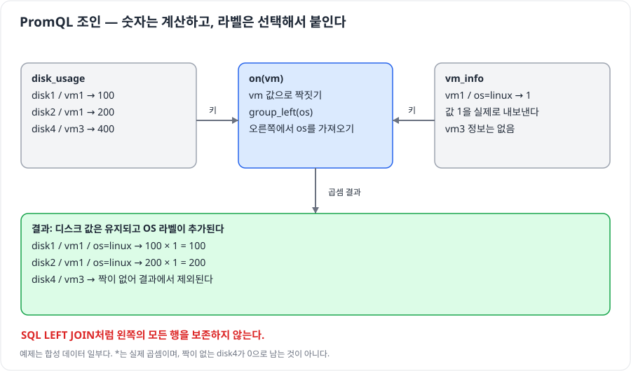
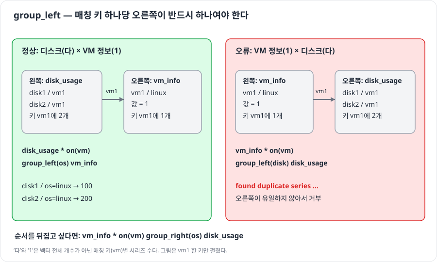

# PromQL 조인 — 값을 유지하면서 라벨을 붙이려면?

## 출처

- **강의**: 사용자가 첨부한 PromQL JOIN 강의 전사본 한 편.
- **식별**: “이번 수업에서는 PromQL의 JOIN 쿼리를…”로 시작, 약 24분 37초. 강의명·저자·원문 URL은 첨부에 없다.
- **대응**: 01:29~05:00 활용 화면, 05:07~07:16 CPU 계산, 07:29~10:24 기본 매칭, 10:30~14:36 group 방향, 14:53~24:37 Grafana 실습.

> 원문 요약은 이 강의만 대상으로 한다. **(보충·교정)**은 공식 문서·소스와 실제 실행으로 확인한 설명이다. 확인일: 2026-10-24.
> 그림은 강의 예시와 교정한 동작을 바탕으로 직접 그렸다. 기존 자동 검증은 합성 데이터를 실제 Prometheus 3.5.0의 promtool 엔진에서 평가했다. 이후 실제 Kubernetes 메트릭과 Grafana 패널을 직접 조작하는 [기능 실습](실습.md)을 추가했다. 두 검증의 범위와 결과는 구분한다.

---

## AI 요약

### 0. 답부터 — 측정값에 값 1인 정보 메트릭을 곱한다

> **공통 라벨로 짝을 찾고, 정보 메트릭의 라벨을 붙인다. 정보 메트릭이 실제로 `1`을 내보내므로 곱해도 측정값은 유지된다.**

| 용어 | 뜻 |
| --- | --- |
| 시리즈(series) | 메트릭 이름·라벨 조합 하나. 예: 특정 VM의 특정 디스크 |
| 벡터(vector) | 여기서는 한 시점의 여러 시리즈와 값으로 된 즉시 벡터 |
| 매칭 키 | 두 벡터의 시리즈를 짝짓는 라벨. `on(vm)`이면 `vm` |
| `group_left(os)` | 왼쪽의 키당 여러 시리즈를 허용하며 오른쪽의 `os` 라벨을 가져오는 지정 |
| 정보 메트릭(info metric) | 버전·이름 같은 정보를 라벨로 제공하는 메트릭. 여기의 예시는 숫자 값 `1`을 제공 |
| 카디널리티(cardinality) | 시리즈 개수. 조인에서는 **매칭 키별 개수**가 중요 |
| 집계(aggregation) | 여러 시리즈를 `sum`, `avg` 등으로 묶어 계산하는 것 |
| 카운터(counter) | 요청 수·누적 CPU 시간처럼 증가하다가 재시작 등으로 리셋될 수 있는 누적형 메트릭 |



**(보충·교정)** “값이 없어서 기본값 1이 된다”는 강의 설명은 고친다. `node_uname_info`는 exporter가 **명시적으로 값 1을 생성**한다. 일반 시리즈에 숫자가 없으면 PromQL이 임의로 1을 채우는 것이 아니다. [node_exporter 소스](https://github.com/prometheus/node_exporter/blob/master/collector/uname.go)

| 질문 | 한 줄 답 | 근거 |
| --- | --- | --- |
| `*`는 조인 문법용 기호인가? | 실제 곱셈이다. 값이 1인 상대와 곱하므로 원래 값이 유지된다 | PoC J2·J4 |
| `group_left`의 “다”는 어디인가? | 왼쪽. 오른쪽은 매칭 키당 하나여야 한다 | 1절 / PoC E2 |
| 왜 조인 후 데이터가 사라지는가? | 짝이 없거나, 집계가 매칭 키를 없앴을 수 있다 | 2절 / PoC J6·J9 |

### 1. 방향 — 남길 세부 시리즈를 왼쪽에 놓는다

> **`group_left`는 왼쪽 여러 시리즈에 오른쪽의 유일한 시리즈를 대응시킨다. SQL LEFT JOIN처럼 누락 행을 보존한다는 뜻이 아니다.**



```promql
disk_usage * on (vm) group_left (os) vm_info
```

| 조각 | 역할 |
| --- | --- |
| `disk_usage` | 디스크별 측정값을 가진 왼쪽 벡터 |
| `on(vm)` | `vm` 라벨 값으로만 짝을 찾는다 |
| `group_left` | 왼쪽의 키당 여러 디스크를 허용한다. 오른쪽은 키당 하나여야 한다 |
| `(os)` | 오른쪽에서 가져올 라벨 이름. 모든 라벨을 자동 복사하지 않는다 |
| `*` | 짝지은 두 시리즈의 숫자를 곱한다 |

**(보충·교정)** 강의 10:30~14:36의 “group_left는 1대다, 기준 벡터가 1”은 방향이 반대다. 공식 정의는 **many-to-one**이다. 전체 시리즈 개수가 아니라 **키 하나에 몇 개가 대응하는지**를 센다. [Prometheus 연산자 문서](https://prometheus.io/docs/prometheus/latest/querying/operators/#many-to-one-and-one-to-many-vector-matches)

| 식 | 결과 | PoC |
| --- | --- | --- |
| `disk_usage * vm_info` | 기본 라벨 집합이 달라 빈 결과 | J1 |
| `disk_usage * on(vm) vm_info` | 왼쪽 키가 여러 개인데 group 지정이 없어 오류 | E1 |
| `disk_usage * on(vm) group_left(os) vm_info` | disk1=100, disk2=200, disk3=300에 OS 추가 | J2 |
| `vm_info * on(vm) group_right(os) disk_usage` | 위 곱셈과 같은 값·라벨 | J3 |
| `vm_info * on(vm) group_left(disk) disk_usage` | 오른쪽 vm1에 디스크가 둘이라 중복 오류 | E2 |
| `disk_usage + on(vm) group_left(os) vm_info` | 값이 101·201·301이 됨 | J4 |

**(보충)** `group_right`는 오른쪽을 “다”로 허용하고 왼쪽에서 지정 라벨을 가져온다. 곱셈은 순서를 바꿔도 값이 같지만, 나눗셈·뺄셈은 좌우 순서를 바꾸면 계산 값도 달라진다. 라벨 방향과 산술 순서를 별도로 읽는다.

<details>
<summary>누락과 중복을 직접 진단하는 질의</summary>

PoC에는 메타데이터가 없는 `disk4{vm="vm3"}=400`도 있다. 조인 결과는 4개가 아닌 3개다.

```promql
# 상대 정보가 없는 원본 시리즈 확인. PoC J6에서 disk4=400.
disk_usage unless on(vm) vm_info

# 오른쪽 키가 중복됐는지 확인. PoC J7에서 vm1=2.
count by(vm) (vm_info_duplicate) > 1
```

**(보충)** 실제 Kubernetes에서 오른쪽에 `kube_pod_labels`를 쓴다면 `count by(namespace,pod)(kube_pod_labels) > 1`로 먼저 확인한다. 여러 kube-state-metrics 대상·스크레이프 job이 같은 리소스를 중복 제공할 수 있다. 원인을 확인한 뒤 적절한 job·cluster 범위로 좁힌다. 서로 다른 업무 라벨을 무조건 `max`로 합치면 잘못된 분류를 숨길 수 있다.

`group_left`는 오른쪽 중복을 해결하는 옵션이 아니다. 오른쪽을 키당 하나로 만들지 못하면 `found duplicate series ... many-to-many matching not allowed` 오류가 난다.

</details>

### 2. 순서 — 조인할 키가 살아 있을 때 대상을 고른다

> **집계가 `pod`를 없앴다면 뒤에 `on(namespace,pod)`를 붙여도 짝을 찾을 수 없다.**


```promql
sum by (namespace, pod) (
  container_memory_working_set_bytes{container!="", container!="POD"}
  * on (namespace, pod) group_left
  kube_pod_labels{label_component="frontend-server"}
)
```

**(보충)** 파드 이름은 네임스페이스가 다르면 같을 수 있다. `on(pod)`만 사용하면 다른 파드끼리 섞이거나 중복 오류가 난다. 여러 클러스터를 한곳에서 질의한다면 양쪽에 실제로 존재하는 `cluster` 같은 구분 키도 보존·매칭한다. PoC E4는 동명 파드 충돌을 재현한다.

| 처리 | 합성 입력 | 결과 |
| --- | --- | --- |
| 필터 → 파드별 합 | team-a/portal의 app=120, sidecar=30 | team-a/portal=150 (J8) |
| 네임스페이스별 합 → 파드 조인 | `pod` 라벨이 제거된 team-a=150 | 빈 결과 (J9) |

**(보충·교정)** “sum 밖에서는 언제나 조인할 수 없다”는 뜻은 아니다. `sum by(namespace,pod)(...)`처럼 키를 보존하면 집계 뒤에도 조인할 수 있다. 중요한 것은 쿼리의 위치보다 **그 단계에 남은 라벨**이다.

<details>
<summary>괄호가 필요한 경우와 CPU 식의 예외</summary>

`*`는 `-`보다 먼저 계산된다. 다음은 `total - (available에 이름을 붙인 결과)`가 된다.

```promql
# 두 벡터의 라벨 집합이 달라져 빈 결과: PoC J12
node_memory_MemTotal_bytes
- node_memory_MemAvailable_bytes
  * on(instance) group_left(nodename) node_uname_info

# 뺄셈을 먼저 하면 instance별 사용 메모리에 이름을 붙일 수 있다: PoC J13
(node_memory_MemTotal_bytes - node_memory_MemAvailable_bytes)
* on(instance) group_left(nodename) node_uname_info
```

**(보충·교정)** 강의의 CPU 식 `1 - ...`에서 `1`은 스칼라(단일 숫자)다. info 값이 1인 이 사례는 괄호가 없어도 같은 값·라벨이 나온다(J10~J11). 따라서 “1로 시작하므로 괄호 없이는 반드시 실패한다”고 설명하지 않는다. 전체 계산에 라벨을 붙인다는 의도를 보여 주기 위해 괄호를 쓰는 것은 좋다.

</details>

### 3. 활용 — 스펙별·담당 컴포넌트별·노드 이름별 화면

> **측정값에 업무 라벨을 연결하면, 파드 이름과 IP를 패널에 계속 수작업으로 등록할 필요가 줄어든다.**

| 만들 화면 | 측정값 쪽에 필요한 키 | 정보 메트릭 | 붙이거나 거를 라벨 |
| --- | --- | --- | --- |
| High/Low Spec 노드 | `node` | `kube_node_labels` | `label_resource` |
| 포탈 담당자용 파드 | `namespace,pod` | `kube_pod_labels` | `label_component` |
| IP 대신 노드 이름 | `instance` | `node_uname_info` | `nodename` |

**(보충)** `instance="IP:9100"`과 `node="worker-1"`은 같은 값이 아니다. 양쪽 원시 결과에 실제 공통 키가 있어야 조인할 수 있다. “기존 쿼리 뒤에 아무 조인이나 붙인다”는 접근은 피한다.

<details>
<summary>강의의 화면을 만드는 설정·완성 질의·Grafana 순서</summary>

Kubernetes 라벨 예시:

```bash
kubectl label node <high-spec-node> resource=high-spec --overwrite
kubectl label node <low-spec-node> resource=low-spec --overwrite
```

파드 라벨은 Deployment의 `spec.template.metadata.labels`에 선언하면 새 레플리카에도 적용된다. 기존 파드에만 수동으로 붙이면 재생성 때 사라질 수 있다.

```yaml
# kube-prometheus-stack values. 강의는 [*]를 허용했지만 필요한 키만 지정한다.
kube-state-metrics:
  metricLabelsAllowlist:
    - 'nodes=[resource]'
    - 'pods=[component]'
```

**(보충)** 실제 키가 `app.kubernetes.io/component`라면 허용 목록에는 그 원래 키를 적고, 질의에는 `label_app_kubernetes_io_component`를 사용한다. 라벨 키 정규화·충돌 처리를 확인한다. `[*]`는 라벨 집합과 변경 시 생기는 시리즈·저장 부담을 키울 수 있다. [라벨 허용 목록](https://github.com/kubernetes/kube-state-metrics/blob/main/docs/developer/cli-arguments.md), [메트릭 라벨 변환](https://github.com/kubernetes/kube-state-metrics#conflict-resolution-in-label-names)

노드에 배치된 컨테이너들의 CPU requests를 스펙별로 분리하는 예시다. 실제 사용률이 아니라 **예약량**, 단위는 CPU 코어다.

```promql
sum by(node) (
  kube_pod_container_resource_requests{resource="cpu", unit="core", node!=""}
)
* on(node) group_left(label_resource)
kube_node_labels{label_resource="high-spec"}
```

Low Spec 패널은 조건을 `low-spec`으로 바꾼다. node별 requests와 limits·사용량은 각각 다른 메트릭이므로 패널 제목과 단위를 확인한다. [파드 메트릭 정의](https://github.com/kubernetes/kube-state-metrics/blob/main/docs/metrics/workload/pod-metrics.md)

노드 CPU 사용률에 노드 이름 붙이기:

```promql
(
  1 - avg by(instance) (
    rate(node_cpu_seconds_total{mode="idle"}[5m])
  )
)
* on(instance) group_left(nodename)
node_uname_info
```

`idle 누적 시간 → 초당 idle 비율 → 코어 평균 → 1에서 빼기` 순서다. 결과 `0.2`는 20%이므로 Grafana 단위는 0~1 비율에 맞춘다. 여기서는 30초 수집에서도 1분 창보다 샘플을 넉넉히 쓰도록 `[5m]`를 예시로 들었다. 값이 어느 정도 평활화되는지도 함께 고려한다.

Grafana에서는 원본 대시보드를 복사하고, High/Low Spec Row에 패널을 복사한다. 포탈 패널은 2절 질의를 적용한다. 숨겨진 쿼리와 expression 의존 관계도 확인한다. 노드 패널의 수동 IP override를 제거하고 레전드를 `{{nodename}}`으로 지정한다. 이 강의의 Row 복사·숨겨진 expression·override 전체를 자동 재현한 것은 아니다. 직접 쿼리와 범례를 수정하는 순서는 [기능 실습 4~7단계](실습.md)에 따로 준비했다.

</details>

### 4. CPU 계산 — rate의 창 경계를 확인한다

> **`rate`는 counter의 초당 평균 증가율이다. 창의 왼쪽 경계에 있는 샘플은 제외하며, 리셋과 창 끝 보정을 처리한다.**

**(보충·교정)** 전사본에 없는 숫자를 강의 결과에서 역산해 확정하지 않는다. 아래는 강의 설명을 점검하기 위해 **직접 정의한 합성 입력**이다.

| 시각 | counter 값 |
| --- | ---: |
| 0초 | 10 |
| 30초 | 20 |
| 60초 | 35 |

| 60초 시점의 질의 | 선택 범위·샘플 | 실제 결과 |
| --- | --- | ---: |
| `count_over_time(demo_counter_total[1m])` | `(0초,60초]`: 20·35 | 2개 |
| `rate(demo_counter_total[1m])` | 위 두 샘플로 증가율·경계 보정 | 0.5/초 |
| `rate(demo_counter_total[61s])` | `(-1초,60초]`: 10·20·35 | 약 0.4167/초 |

강의식 “두 구간의 증가율 평균”은 균일한 간격·리셋 없는 예시의 직관이다. 실제 `rate` 알고리즘 정의로 외우면 안 된다. `100 → 5 → 15` 입력도 리셋으로 보정해 음수 대신 `0.25/초`가 나오는 것을 확인했다. [범위 선택 경계](https://prometheus.io/docs/prometheus/latest/querying/basics/#range-vector-selectors), [rate 정의](https://prometheus.io/docs/prometheus/latest/querying/functions/#rate)

---

## PoC — 직접 확인한 것

**직접 해보려면 [기능 실습의 4~7단계](실습.md)로 간다.** 실제 노드 이름·메모리·파드 라벨로 패널을 만든 뒤 Deployment의 라벨과 레플리카를 바꾸며 표시 대상이 달라지는 것을 확인한다. 아래는 수식의 동작을 더 확인하고 싶을 때 사용하는 보조 자동 검증이다.

```bash
python3 'infra/쿠버네티스 스프린트 4/run.py' promql
```

| 시나리오 | 실제 관찰 | 연결 |
| --- | --- | --- |
| J1~J5, E1~E3 | 라벨 선택·OS 부착·값 보존·덧셈·group 방향·중복 오류 | 0~1절 |
| J6~J7 | 정보가 없는 disk4=400 탐지, 중복 키 vm1=2 탐지 | 1절 상세 |
| J8~J9, E4 | 파드 필터 후 합은 150; 키를 없애면 빈 결과; namespace 누락은 충돌 | 2절 |
| J10~J13 | CPU 스칼라 식의 예외와 두 벡터 뺄셈의 괄호 차이 | 2절 상세 |
| R1~R4 | 샘플 경계 2개, 0.5 대 0.4167, counter reset 보정 | 4절 |

**실행 결과: 21/21 통과.** 정상 질의 17개는 결과 라벨·값을 엔진의 출력과 비교했고, 의도한 오류 4개는 실패 여부와 오류 내용을 확인했다. 샘플·평가 시각은 고정돼 있다. [코드와 재현 방법](<자동 검증.md>)

---

## 내가 얻은 인사이트

1. **(내 해석) 조인은 분류 정책을 질의에 연결한다.** 노드 스펙·담당 컴포넌트를 라벨로 관리하면 패널의 수작업 수정이 줄어든다. 라벨의 정확성은 운영 책임으로 남는다.
2. **(내 해석) 오류보다 조용한 누락이 더 놓치기 쉽다.** 메타데이터 없는 시리즈는 산술 조인에서 사라진다. `unless` 질의로 누락도 따로 확인한다.
3. **(내 해석) 유일성은 조인의 전제다.** `group_left`부터 붙이지 말고 오른쪽이 매칭 키당 하나인지 확인한다. `namespace`·`cluster`를 지우면 이 전제가 깨진다.
4. **(내 해석) 쿼리는 단계별 라벨 표로 읽는다.** 집계 전후에 어떤 키가 남는지 적으면 빈 결과의 원인을 찾기 쉽다.
5. **(내 해석) 샘플 간격과 조회 창은 계산의 일부다.** 같은 숫자라도 창 경계에 따라 결과가 바뀐다. 발표에서는 입력 시각·질의 창·엔진 결과를 함께 제시한다.
