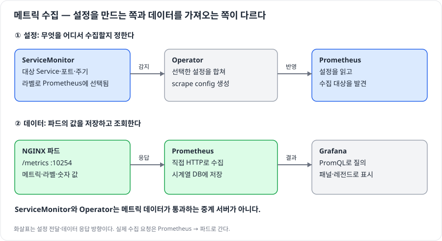
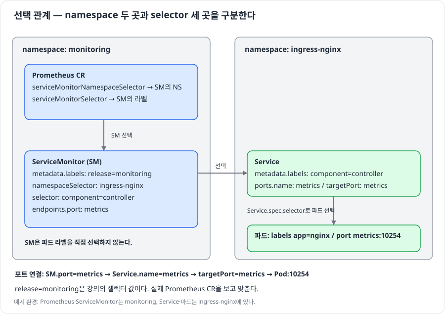
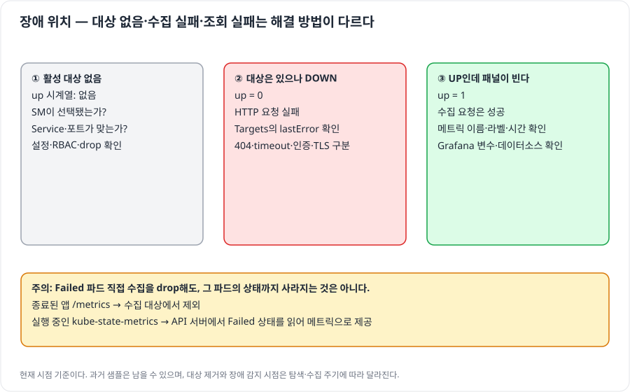

# ServiceMonitor — 메트릭을 켰는데 왜 Prometheus에 안 보일까?

## 출처

- **강의**: 사용자가 첨부한 ServiceMonitor·NGINX 메트릭 연동 강의 전사본 한 편.
- **식별**: “이번 수업부터는 모니터링에서 자주 쓰게 되는 기능들을…”로 시작, 약 27분 48초. 강의명·저자·원문 URL은 첨부에 없다.
- **대응**: 00:18~06:50 수집 구조, 06:58~12:22 설정 실패 사례, 13:05~17:44 선택 관계, 17:47~23:40 scrape config, 23:43~27:48 Targets·Grafana.

> 원문 요약은 이 강의만 대상으로 한다. **(보충)**은 공식 문서로 확인한 교정·추가 설명이며 해당 문단에 링크했다. 확인일: 2026-10-24.
> 그림은 강의 내용과 표시한 보충 설명을 바탕으로 직접 그렸다. 기존 자동 검증은 실제 Prometheus 3.5.0으로 실행했다. 이후 실제 Kubernetes·Operator·NGINX를 조작하는 [기능 실습](실습.md)을 별도로 추가했다. 두 검증의 범위와 결과는 구분한다.

---

## AI 요약

### 0. 답부터 — 노출·대상 선택·실제 수집을 따로 확인한다

> **`metrics.enabled=true`는 메트릭을 내보내는 설정이다. Prometheus가 그 대상을 선택하고 요청에 성공해야 조회할 수 있다.**

| 용어 | 뜻 |
| --- | --- |
| 메트릭(metric) | 이름·라벨·숫자 값으로 노출되는 관측 데이터 |
| 스크레이프(scrape) | Prometheus가 대상의 HTTP `/metrics`를 주기적으로 요청하는 동작 |
| Service | 파드 집합과 포트를 연결하는 Kubernetes 리소스 |
| ServiceMonitor | 어떤 Service의 어느 포트를 수집할지 선언하는 사용자 정의 리소스 |
| Prometheus CR | 이 Prometheus 인스턴스가 사용할 모니터 등을 선언한 리소스. CRD는 그 리소스 종류의 정의 |
| Operator | 선언한 리소스를 읽고 Prometheus 설정·워크로드를 관리하는 컨트롤러 |
| exporter / kube-state-metrics | 메트릭을 HTTP로 노출하는 프로그램 / Kubernetes API의 리소스 상태를 메트릭으로 노출하는 프로그램 |
| 시계열(series) | 같은 메트릭 이름과 라벨 조합에 쌓이는 시간별 값 |



ServiceMonitor는 메트릭 전달 경로에 있는 서버가 아니다. **설정을 만드는 경로와 데이터를 수집하는 경로가 다르다.** Grafana는 Prometheus에 저장된 데이터를 질의한다.

| 질문 | 한 줄 답 | 근거 |
| --- | --- | --- |
| ServiceMonitor만 만들면 되는가? | Prometheus CR에 선택되고 Service·포트까지 연결돼야 한다 | 1절 |
| Targets가 DOWN인가, 대상 자체가 없는가? | 전자는 요청 실패, 후자는 선택·탐색·필터부터 확인한다 | 2절 / PoC S1~S5 |
| 종료된 파드를 drop하면 Failed 상태도 못 보는가? | 상태를 내보내는 별도 exporter까지 제외한 것은 아니다 | 3절 / PoC S6 |

### 1. 선택 조건 — 누가 누구의 라벨을 보는가?

> **Prometheus는 ServiceMonitor를, ServiceMonitor는 Service를, Service는 파드를 고른다.**



| 설정 위치 | 고르는 대상 | 맞출 값 |
| --- | --- | --- |
| Prometheus `serviceMonitorNamespaceSelector` | ServiceMonitor가 있는 네임스페이스 | 해당 네임스페이스의 라벨 |
| Prometheus `serviceMonitorSelector` | ServiceMonitor | ServiceMonitor의 `metadata.labels` |
| ServiceMonitor `namespaceSelector` | Service가 있는 네임스페이스 | `matchNames`의 네임스페이스 이름 |
| ServiceMonitor `selector` | Service | Service의 `metadata.labels` |
| Service `spec.selector` | 파드 | 파드의 라벨 |

**(보충)** Prometheus CR에서 `serviceMonitorSelector: {}`는 모든 ServiceMonitor 라벨을 허용한다. 반면 `serviceMonitorNamespaceSelector`는 `{}`이면 모든 네임스페이스, 생략·null이면 자기 네임스페이스다. Helm values의 `{}`가 실제 CR에서도 그대로 `{}`인지 렌더링 결과를 확인한다. [Operator API](https://prometheus-operator.dev/docs/api-reference/api/), [차트 values](https://github.com/prometheus-community/helm-charts/blob/main/charts/kube-prometheus-stack/values.yaml)

**(보충)** 차트의 `serviceMonitorSelectorNilUsesHelmValues: true`는 values의 빈 selector를 Helm 릴리스 기반 선택 조건으로 바꿀 수 있다. 이를 `false`로 바꾸는 것과 `serviceMonitorNamespaceSelector`를 바꾸는 것은 다른 설정이다. 선택 범위를 넓히기 전에 실제 CR에서 어느 조건이 막혔는지 확인한다.

강의의 `release: monitoring`은 kube-prometheus-stack이 만든 선택 조건에 맞춘 값이다. **(보충)** `release`는 Prometheus 프로토콜의 예약 규칙이 아니다. 사용자 환경의 CR이 다른 라벨을 요구하면 그 라벨에 맞춘다. 네임스페이스 문제와 라벨 문제를 따로 확인한다.

<details>
<summary>강의 환경의 values와 리소스 연결 예시</summary>

기존 ingress-nginx 설치의 values 예시다. 필드는 [controller-v1.13.0의 차트 values](https://github.com/kubernetes/ingress-nginx/blob/controller-v1.13.0/charts/ingress-nginx/values.yaml)와 대조했다. 실제 적용은 설치된 차트 버전으로 확인한다. 이 파일만으로 Prometheus나 CRD가 설치되는 것은 아니다.

```yaml
# ingress-nginx values
controller:
  metrics:
    enabled: true
    serviceMonitor:
      enabled: true
      namespace: monitoring
      additionalLabels:
        release: monitoring
      scrapeInterval: 30s
```

```yaml
# Prometheus CR의 관련 필드 예시
spec:
  serviceMonitorSelector:
    matchLabels:
      release: monitoring
  serviceMonitorNamespaceSelector: {}
---
# ServiceMonitor의 관련 필드 예시
metadata:
  namespace: monitoring
  labels:
    release: monitoring
spec:
  namespaceSelector:
    matchNames: [ingress-nginx]
  selector:
    matchLabels:
      app.kubernetes.io/component: controller
      app.kubernetes.io/instance: ingress-nginx
      app.kubernetes.io/name: ingress-nginx
  endpoints:
    - port: metrics
      interval: 30s
---
# Service의 관련 필드 예시
spec:
  ports:
    - name: metrics
      port: 10254
      targetPort: metrics
```

**(보충)** `endpoints.port`는 Service 포트의 **이름**이다. `10254`나 문자열 `"10254"`를 무작정 넣는 자리가 아니다. Service의 `targetPort`는 숫자 또는 파드 포트 이름으로 연결할 수 있다. [Operator 문제 해결](https://prometheus-operator.dev/docs/platform/troubleshooting/)

Annotation 방식은 그 Annotation을 읽는 별도 탐색·relabel 설정이 있어야 동작한다. PodMonitor는 Service 대신 파드를 선택한다. 탐색 방식을 섞기 전에 설치된 설정을 확인한다. [Operator 설계](https://prometheus-operator.dev/docs/getting-started/design/)

</details>

### 2. 문제 해결 — “안 보인다”를 세 증상으로 나눈다

> **현재 활성 대상이 없는 상태와, 대상에 요청했지만 실패한 상태를 구별한다.**



| 관찰 | 다음 확인 | 피해야 할 추측 |
| --- | --- | --- |
| 생성된 설정에 해당 job도 없음 | Prometheus의 SM 선택 조건, Operator Event·감시 범위 | Operator를 재시작하면 해결된다 |
| job은 있으나 활성 대상 없음 | Service 라벨·네임스페이스·포트, EndpointSlice/Endpoints, RBAC, relabel drop | 무조건 인증서 문제다 |
| 활성 대상 `DOWN`, `up=0` | Targets의 `lastError`: 404·timeout·403·TLS 오류 등 | ServiceMonitor만 다시 만든다 |
| `UP`, `up=1`인데 패널이 빔 | 원시 메트릭·라벨·조회 시간·Grafana 데이터소스·변수 | UP이므로 모든 메트릭이 존재한다 |

**(보충)** `up`은 수집 요청의 성공 여부다. 앱의 모든 기능이 정상이라는 뜻은 아니다. 미등록·제외된 대상은 현재 `up` 시계열 자체가 없을 수 있다. 과거 데이터가 즉시 삭제되는 것은 아니다. 이 차이는 PoC S1~S5에서 확인했다.

<details>
<summary>실제 클러스터에서 따라갈 점검 명령과 설정 읽기</summary>

아래 명령은 기존 클러스터용 안내다. 이번 PoC에서 실행한 명령은 아니다. `<이름>`은 조회한 실제 이름으로 바꾼다.

```bash
kubectl get prometheus -A -o yaml
kubectl get servicemonitor -A --show-labels
kubectl get svc -n ingress-nginx --show-labels
kubectl get svc -n ingress-nginx ingress-nginx-controller-metrics -o yaml
kubectl get endpointslice -n ingress-nginx \
  -l kubernetes.io/service-name=ingress-nginx-controller-metrics -o yaml
kubectl get events -n monitoring \
  --field-selector involvedObject.name=<servicemonitor-name>

# 파드 이미지에 curl이 있을 때. 없으면 해당 Pod/Service로 port-forward 후 로컬 curl.
kubectl exec -n ingress-nginx <nginx-pod> -- curl -fsS localhost:10254/metrics

# 생성된 파일의 경로는 Pod의 --config.file·volumeMounts로 확인한다.
kubectl exec -n monitoring <prometheus-pod> -c prometheus -- \
  cat /etc/prometheus/config_out/prometheus.env.yaml

# 별도 NodePort 배포 없이 로컬 UI 접속. Ctrl+C로 종료.
kubectl -n monitoring port-forward svc/prometheus-operated 9090:9090
```

**(보충)** Operator는 선택된 모니터로 설정 Secret을 만들고, config-reloader가 설정 변경을 반영한다. 실행 중인 설정·Targets까지 확인해야 반영 성공을 판단할 수 있다. Operator의 감시 네임스페이스·RBAC도 탐색 범위를 제한할 수 있으므로 “모든 ServiceMonitor를 항상 감지한다”고 일반화하지 않는다. [문제 해결](https://prometheus-operator.dev/docs/platform/troubleshooting/)

강의는 `role: endpoints`를 사용한다. **(보충)** 현재 구성은 `EndpointSlice`를 사용할 수도 있다. 생성된 `kubernetes_sd_configs.role`과 해당 리소스·권한을 함께 확인한다. [Operator 설계](https://prometheus-operator.dev/docs/getting-started/design/)

| 생성된 scrape config | 읽는 방법 |
| --- | --- |
| `action: keep` | 조건에 맞는 수집 대상만 남긴다 |
| `source_labels: [a,b]`, `separator: ;` | 두 라벨 값을 `a값;b값`으로 이어 정규식에 대입한다 |
| `regex: Pod;(.*)`, `replacement: ${1}`, `target_label: pod` | `Pod;<이름>`에서 이름을 추출해 대상 라벨 `pod`로 만든다 |
| `action: drop`, `regex: Failed\|Succeeded` | 종료된 **대상**을 수집 목록에서 제외한다 |
| `honor_labels: false` | 겹치는 라벨은 대상 라벨을 쓰고, 노출 데이터의 원래 라벨은 `exported_<이름>`으로 보존한다 |
| `honor_labels: true` | 겹치는 라벨은 노출 데이터의 라벨을 쓴다 |

`honor_labels`의 충돌 처리 근거: [Prometheus 설정](https://prometheus.io/docs/prometheus/latest/configuration/configuration/). PoC S7~S8에서 실제 라벨 결과를 비교했다.

TLS 오류는 오류 메시지에 맞춰 CA·서버 이름·클라이언트 인증서를 점검한다. **(보충)** 서버 인증서 검증 생략은 필요한 클라이언트 인증서를 대신하지 못한다. 강의의 `insecureSkipVerify`를 모든 DOWN의 해결책으로 일반화하지 않는다. [Prometheus HTTP 설정](https://prometheus.io/docs/prometheus/latest/configuration/configuration/#http_config)

</details>

### 3. 수집 정책 — 대상의 종료와 관측 데이터의 소멸은 다르다

> **종료된 앱을 직접 수집하지 않아도, 실행 중인 kube-state-metrics가 그 파드의 Failed 상태를 내보낼 수 있다.**

강의는 종료된 파드의 `/metrics`를 수집할 이유가 없어 `Failed|Succeeded` 대상을 제외한다고 설명한다. **(보충)** 이 규칙만으로 `kube_pod_status_phase{phase="Failed"}`까지 사라지지는 않는다. 이 메트릭은 kube-state-metrics가 Kubernetes API의 상태를 읽어 제공한다. 파드 리소스가 삭제되면 해당 상태 시리즈도 계속 제공되는 것은 아니다. [kube-state-metrics 파드 메트릭](https://github.com/kubernetes/kube-state-metrics/blob/main/docs/metrics/workload/pod-metrics.md)

| 수집 간격 | 얻는 것 | 비용·한계 |
| --- | --- | --- |
| 짧게 | 변화 구간을 더 촘촘하게 관측 | 요청·샘플·저장량 증가 |
| 길게 | 수집·저장 비용 감소 | 짧은 변화 누락, 탐지 지연 가능 |

**(보충)** 30초 간격이라고 장애가 항상 정확히 30초 안에 경보로 이어지는 것은 아니다. 대상 탐색, scrape timeout, 규칙 평가 주기, 알림의 `for` 시간도 관여한다. Grafana 공개 대시보드를 가져온 뒤에는 데이터소스·변수·메트릭 이름·라벨이 내 수집 설정과 맞는지 확인한다.

---

## PoC — 직접 확인한 것

**직접 해보려면 [기능 실습의 1~3단계](실습.md)부터 진행한다.** 실제 ServiceMonitor를 만들고 release·port·path를 바꿔 job 없음·활성 대상 없음·DOWN·UP을 비교한다. 아래는 고정 입력으로 진행한 보조 자동 검증이다.

```bash
python3 'infra/쿠버네티스 스프린트 4/run.py' scrape
```

| 시나리오 | 실제 관찰 | 연결 |
| --- | --- | --- |
| S1~S3 | 정상 대상 `up=1`, HTTP 404 대상 `up=0`, `lastError`에 404 | 2절 |
| S4~S5 | drop 대상·미등록 job은 `up` 결과가 빈 벡터 | 2절 |
| S6 | Failed 대상은 제외되면서 별도 exporter의 Failed 상태 값은 `1` | 3절 |
| S7~S8 | false: `pod=discovered-pod`, `exported_pod=exporter-pod`; true: `pod=exporter-pod` | 2절 상세 |

**보조 자동 검증 결과: 8/8 통과.** 합성 HTTP exporter와 실제 Prometheus를 사용했다. `discovered_phase`라는 합성 대상 라벨로 drop 동작을 재현했다. 이 8개 검증에는 ServiceMonitor 선택·Operator·NGINX 자체가 포함되지 않는다. 실제 클러스터의 기능 실습은 [별도 실습서](실습.md)와 [검증 기록](<점검 기록.md>)을 따른다. 실제 TLS 장애는 다루지 않는다.

---

## 내가 얻은 인사이트

1. **(내 해석) “대상이 있나?”를 먼저 묻는다.** 대상 없음과 DOWN을 나누면 선택 설정을 볼지 네트워크 요청을 볼지 바로 정할 수 있다.
2. **(내 해석) 라벨은 이름표이면서 연결 조건이다.** 같은 `selector`라는 이름이어도 고르는 리소스가 다르므로 설정과 대상을 나란히 읽는다.
3. **(내 해석) 상태의 생산자를 확인한다.** 앱 메트릭과 kube-state-metrics의 상태 메트릭은 수집 대상이 다르다. 빈 패널만 보고 장애 감지 불가라고 결론내리지 않는다.
4. **(내 해석) 설치 성공보다 수집 증거가 중요하다.** 생성된 job, 활성 target, `lastError`, 원시 질의까지 확인한 뒤 대시보드를 고친다.
