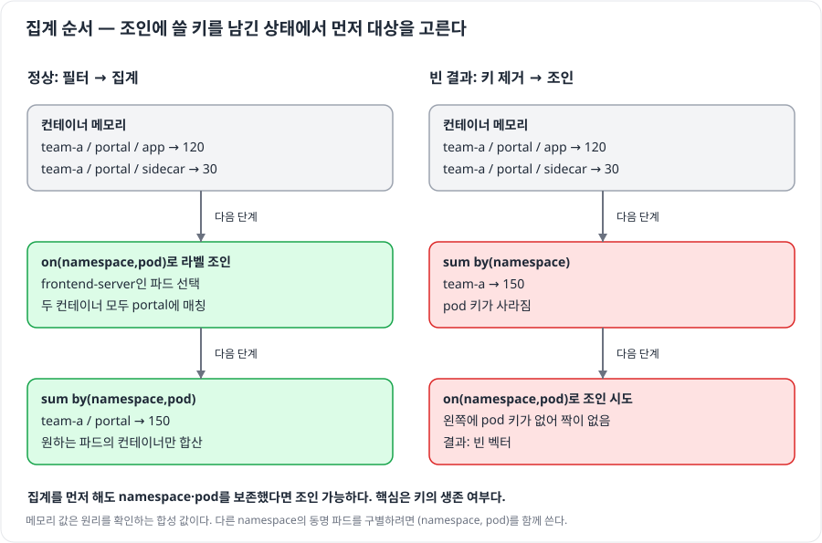

# 직접 해보는 스프린트 4 — ServiceMonitor 연결부터 라벨로 바뀌는 대시보드까지

**목표는 정답 숫자를 맞히는 것이 아니라, 내가 바꾼 설정이 실제 화면과 수집 대상에 어떻게 반영되는지 보는 것이다.** 준비만 자동화하고 아래 조작은 직접 한다. 처음에는 1~3단계만 해도 좋다.

| 단계 | 직접 하는 일 | 관찰할 변화 |
| --- | --- | --- |
| 1 | 포탈에 실제 요청 보내기 | NGINX의 `/metrics`에는 값이 있지만 Prometheus에는 대상 없음 |
| 2 | ServiceMonitor 만들고 release 라벨 고치기 | 객체 있음·job 없음 → job 생김 → Target UP |
| 3 | 포트 이름과 요청 경로를 각각 틀리게 바꾸기 | 대상 없음과 DOWN의 차이 |
| 4 | Grafana에서 노드 이름 조인하기 | IP 범례 → 실제 노드 이름 |
| 5 | 파드 메모리에 컴포넌트 라벨 조인하기 | 전체 앱 → frontend 파드만 표시 |
| 6 | Deployment 라벨·레플리카 바꾸기 | 쿼리 수정 없이 새 파드가 패널에 들어옴 |
| 7 | 노드 라벨로 패널 필터하기 | high-spec 선택 범위가 라벨 변경을 따라 바뀜 |

## 0. 전용 환경 준비

Docker Desktop/Docker Engine이 실행 중이어야 한다. 도구·차트·컨테이너 이미지를 처음 받을 때 인터넷 연결과 몇 GB의 디스크 공간이 필요하다. Docker에 메모리 6GB 이상을 배정하는 구성을 기준으로 한다.

저장소 루트에서 아래 폴더로 이동한다. **이후 모든 명령은 이 폴더에서 실행한다.**

```bash
cd 'infra/쿠버네티스 스프린트 4'
python3 lab.py setup
```

별도 kind 클러스터 `sprint4-monitoring`에 다음을 설치한다. 사용자의 `~/.kube/config`와 현재 context는 변경하지 않는다. `lab.py k`는 이 실습의 kubeconfig·context를 지정해 실행하는 실제 kubectl이다.

| 설치 대상 | 역할 |
| --- | --- |
| kind 노드 2개 | 실제 Kubernetes API·파드·Service·EndpointSlice 제공 |
| kube-prometheus-stack | 실제 Operator·CRD·Prometheus·Grafana·kube-state-metrics·node-exporter |
| ingress-nginx | 강의와 같은 10254 `/metrics`·메트릭용 Service |
| apps/portal 2개, apps/api 1개 | 프론트엔드·백엔드 역할 라벨을 가진 실제 NGINX 파드 |
| 시작 대시보드 | 아직 조인하지 않은 패널. 사용자가 사본에서 쿼리 수정 |

> 강의 재현을 위해 ingress-nginx 차트 4.14.4를 로컬 전용으로 사용한다. 이 프로젝트는 2026-03에 종료됐으며, 이 구성은 새 운영 환경의 Ingress 선택 안내가 아니다. [공식 공지](https://kubernetes.io/blog/2025/11/11/ingress-nginx-retirement/)

설치 버전은 [README](README.md)에 고정했다. kind의 두 노드는 같은 Docker VM 자원을 공유한다. `high-spec/low-spec`은 **분류 실습용 라벨**이며 두 물리 장비의 실제 사양 차이를 재현하지 않는다.

**터미널 1**에서 UI를 연다. 종료하지 말고 켜 둔다.

```bash
python3 lab.py ui
```

| 주소 | 사용하는 화면 |
| --- | --- |
| <http://127.0.0.1:19090> | Prometheus Query·Targets·Configuration |
| <http://127.0.0.1:13000> | Grafana. `admin` / `study-local-only`로 로그인 |
| <http://127.0.0.1:10254/metrics> | ingress-nginx가 직접 내보내는 원시 메트릭 |
| `127.0.0.1:18080` | 실습용 Ingress. 아래 traffic 명령이 올바른 Host 헤더로 접근 |

**터미널 2**에서도 같은 폴더로 이동해 아래 단계들을 진행한다.


## 1. 메트릭을 켠 것과 수집된 것을 눈으로 구분하기

> **ServiceMonitor 없이도 NGINX는 `/metrics`를 내보낼 수 있다.**

먼저 리소스의 실체를 확인한다.

```bash
python3 lab.py k get crd servicemonitors.monitoring.coreos.com
python3 lab.py k get deployments -n monitoring
python3 lab.py k get prometheus -n monitoring
python3 lab.py k get pods -n apps --show-labels
python3 lab.py k get svc -n ingress-nginx
```

CRD는 리소스 종류 정의이고, Operator는 `monitoring-operator` Deployment로 실행되는 프로그램이다. Prometheus CR도 따로 있다.

포탈을 실제로 호출한다.

```bash
python3 lab.py traffic --count 100
```

1. 브라우저에서 <http://127.0.0.1:10254/metrics>를 열고 `nginx_ingress_controller_requests`를 검색한다. `ingress="portal"`·`status="200"` 같은 라벨과 누적값을 확인한다. 첫 요청 통계의 반영에 몇 초 걸릴 수 있으므로 없으면 잠시 뒤 새로고침한다.
2. Prometheus Query에서 `nginx_ingress_controller_requests`를 **Table 모드로 현재 시각에** 조회한다. 처음에는 빈 결과다.
3. 터미널에서 현재 설정과 활성 대상을 확인한다.

```bash
python3 lab.py config
python3 lab.py targets
```

**보일 변화:** 원시 메트릭에는 요청 값이 있고, Prometheus에는 `nginx-metrics` job과 활성 대상이 없다. 여기까지는 의도한 초기 상태다.

## 2. ServiceMonitor를 만들고 선택 라벨을 직접 고치기

> **객체가 존재해도 Prometheus의 선택 조건과 맞지 않으면 설정에 들어가지 않는다.**

내가 수정할 YAML을 복사한다. 원본에는 일부러 틀린 `release: not-selected`가 들어 있다.

```bash
cp lab/servicemonitor.yaml .lab/my-servicemonitor.yaml
python3 lab.py k apply -f .lab/my-servicemonitor.yaml
python3 lab.py k get servicemonitor nginx-metrics -n monitoring --show-labels
python3 lab.py config
```

객체는 만들어졌지만 job은 없다. Prometheus CR의 실제 선택 조건도 조회해 본다.

```bash
python3 lab.py k get prometheus -n monitoring \
  -o jsonpath='{.items[0].spec.serviceMonitorSelector}'
```

에디터로 `.lab/my-servicemonitor.yaml`을 열어 **라벨 한 줄만** 바꾼다.

```yaml
metadata:
  labels:
    release: monitoring
```

다시 적용하고 변화를 관찰한다.

```bash
python3 lab.py k apply -f .lab/my-servicemonitor.yaml
python3 lab.py config
python3 lab.py targets
```

몇 초 뒤 다시 조회한다. Prometheus의 Targets 화면에서도 `nginx-metrics`로 검색한다.

**보일 변화:** `serviceMonitor/monitoring/nginx-metrics/0` job이 생기고, 실제 파드 IP의 `:10254/metrics` 대상이 UP으로 바뀐다. 이제 Prometheus Query에서도 NGINX 메트릭이 나온다.

```promql
up{namespace="ingress-nginx"}
```

여기서는 Operator·Prometheus를 재시작하지 않았다. 선택된 리소스의 변경이 실제 수집 설정에 반영된 것이다.

## 3. 포트 이름 오류와 요청 경로 오류를 각각 만들어 보기

> **대상을 못 고른 상태와, 대상을 고른 뒤 요청에 실패한 상태를 구분한다.**


### 3-A. 포트 이름을 틀리게 변경

먼저 Service의 포트 이름과 파드 연결을 조회한다.

```bash
python3 lab.py k get svc ingress-nginx-controller-metrics -n ingress-nginx -o yaml
python3 lab.py k get endpointslice -n ingress-nginx \
  -l kubernetes.io/service-name=ingress-nginx-controller-metrics -o yaml
```

내 YAML의 `endpoints[0].port`를 `metrics`에서 **`not-a-port`**로 바꾸고 적용한다.

```yaml
endpoints:
  - port: not-a-port
    path: /metrics
    interval: 5s
```

```bash
python3 lab.py k apply -f .lab/my-servicemonitor.yaml
python3 lab.py config
python3 lab.py targets
```

**보일 변화:** job은 남지만 NGINX 활성 대상은 0개가 된다. Prometheus Service Discovery에서 dropped 후보도 볼 수 있다. 라벨로 Service를 골랐어도 맞는 이름의 포트가 없기 때문이다.

### 3-B. 포트는 복구하고 요청 경로만 틀리게 변경

같은 YAML에서 포트를 `metrics`로 복구하고, 경로를 **`/not-metrics`**로 바꾼다.

```yaml
endpoints:
  - port: metrics
    path: /not-metrics
    interval: 5s
```

```bash
python3 lab.py k apply -f .lab/my-servicemonitor.yaml
python3 lab.py targets
```

**보일 변화:** 대상은 생기지만 DOWN이 된다. Targets에서 URL과 `lastError`의 HTTP 404를 직접 읽어 본다. `up`의 현재 값은 0이다.

### 3-C. 복구

경로를 `/metrics`로 고쳐 재적용한다. 수정 내용을 잃었으면 정상 복구 파일을 사용한다.

```bash
python3 lab.py k apply -f lab/servicemonitor-working.yaml
python3 lab.py targets
python3 lab.py traffic --count 300 --interval 0.1
```

**보일 변화:** 같은 대상이 UP으로 돌아오고, Prometheus에서 `rate(nginx_ingress_controller_requests{ingress="portal"}[1m])`를 그래프로 보면 실제 요청에 따른 선이 생긴다.

| 내가 바꾼 것 | 설정 job | 현재 활성 대상 | 상태 |
| --- | --- | --- | --- |
| release 틀림 | 없음 | 없음 | 대상 선택 전 |
| port 이름 틀림 | 있음 | 없음 | 포트 필터에서 제외 |
| path 틀림 | 있음 | 있음 | DOWN·HTTP 404 |
| 모두 정상 | 있음 | 있음 | UP |

설정 변경은 즉시 한 화면에 모두 나타나지 않는다. 수 초에서 약 1분 기다리며 새로고침한다. **그래프의 과거 데이터는 남는다.** 현재 상태는 Targets와 Table의 현재 시각으로 확인한다.

<details>
<summary>더 해보기: port를 아예 생략하면?</summary>

`endpoints` 항목은 유지하고 `port` 줄만 지운다. `/metrics`와 `5s`는 그대로 둔다. 적용 후 Targets에서 NGINX의 활성 대상과 URL들을 살펴본다.

```yaml
endpoints:
  - path: /metrics
    interval: 5s
```

특정 포트 이름으로 거르는 조건이 빠져 다른 발견 포트까지 대상이 될 수 있다. 여러 대상에 UP과 DOWN이 섞이는지, 메트릭용이 아닌 포트에도 `/metrics`를 요청하는지 본다. 수집 대상 수는 Service·파드가 노출한 포트 구성에 따라 달라진다.

관찰 후 `python3 lab.py k apply -f lab/servicemonitor-working.yaml`로 복구한다. `port: metrics`는 이 실습에서 원하는 수집 대상을 좁히는 역할이다.

</details>

<details>
<summary>더 해보기: namespace 선택도 직접 틀려 보기</summary>

내 YAML의 `namespaceSelector.matchNames`를 `[does-not-exist]`로 바꾸고 적용한다. job은 있지만 Service를 찾을 네임스페이스가 달라 활성 대상이 사라진다. `[ingress-nginx]`로 복구하거나 정상 복구 파일을 적용한다.

</details>

<details>
<summary>수집한 NGINX 메트릭의 namespace가 원시 출력과 다르다면?</summary>

이 실습의 NGINX 메트릭은 원래 `namespace="apps"`를 내보내지만, 수집 대상에는 `namespace="ingress-nginx"`가 붙는다. 기본 `honor_labels: false`에서 충돌한 원래 값은 `exported_namespace="apps"`로 보존된다. Prometheus Table에서 두 라벨을 직접 비교한다.

그래서 시작 대시보드의 요청 패널은 `ingress="portal"`로 선택한다. 수집 전에 본 라벨과 수집 후 라벨이 달라졌다면 어느 쪽에서 붙인 라벨인지 확인한다. [강의 정리의 honor_labels 설명](ServiceMonitor.md)

</details>

## 4. 내 Grafana 사본에서 IP를 노드 이름으로 바꾸기

> **실제로 수집한 노드 정보와 CPU 메트릭을 연결해 범례를 바꾼다.**

Grafana의 Dashboards에서 **Sprint 4 - 직접 바꾸는 모니터링**을 연다. 먼저 **Save as copy**로 `나의 스프린트 4` 사본을 만든다. 설치된 시작 대시보드는 프로비저닝된 원본이므로 사본에서 저장한다.

두 번째 CPU 패널을 Edit해 기존 쿼리와 범례의 IP를 본다. Prometheus에서도 아래 메트릭을 조회해 `instance`와 `nodename`을 비교한다.

```promql
node_uname_info
```

CPU 패널의 쿼리를 직접 바꾼다.

```promql
(
  1 - avg by(instance) (
    rate(node_cpu_seconds_total{mode="idle"}[1m])
  )
)
* on(instance) group_left(nodename)
node_uname_info
```

범례를 **`{{nodename}}`**으로 바꾼 뒤 저장한다. 단위는 0~1 비율을 퍼센트로 표시하는 단위를 사용한다.

**보일 변화:** 사용률 선은 유지되면서 범례가 IP에서 노드 이름으로 바뀐다. Prometheus Table에서는 결과에 `nodename`이 추가돼 있다. 실제 수집값이므로 CPU 퍼센트는 실행 때마다 다르다.

## 5. 전체 앱 메모리에서 frontend 파드만 남기기

> **직접 수집한 파드 라벨로 대상을 고르고, 파드별 컨테이너 메모리를 합한다.**

먼저 Kubernetes의 라벨과 메트릭에 실린 라벨을 각각 본다.

```bash
python3 lab.py k get pods -n apps -L app,component
```

```promql
kube_pod_labels{namespace="apps"}
```

`component=frontend-server`가 `label_component="frontend-server"`로 나오는지 확인한다. 이 실습에서는 필요한 파드·노드 라벨만 [monitoring-values.yaml](lab/monitoring-values.yaml)의 allowlist에 허용했다.

Grafana 사본의 세 번째 메모리 패널을 Edit한다. 처음에는 portal 2개와 api 1개가 보인다. 다음 쿼리로 바꾸고 제목도 `프론트엔드 파드 메모리`로 바꾼다.

```promql
sum by(namespace, pod) (
  container_memory_working_set_bytes{
    namespace="apps", container!="", container!="POD",
    job="kubelet", metrics_path="/metrics/cadvisor"
  }
  * on(namespace, pod) group_left
  kube_pod_labels{namespace="apps", label_component="frontend-server"}
)
```

**보일 변화:** 현재 시점에 portal 파드 2개만 남는다. Grafana의 과거 선이 보이면 패널의 Table view나 Prometheus Table에서 현재 결과를 확인한다. `namespace,pod`로 구분해 다른 네임스페이스의 동명 파드와 섞이지 않도록 한다.



## 6. 쿼리는 그대로 두고 라벨과 레플리카를 바꾸기

> **업무 라벨이 바뀌면 조회 대상이, 레플리카가 늘면 표시되는 파드 수가 바뀐다.**

api Deployment의 파드 템플릿을 frontend로 바꿔 본다. 이름은 api지만 라벨은 의도적으로 프론트엔드로 바꾸는 실험이다.

```bash
python3 lab.py k patch deployment api -n apps --type merge \
  -p '{"spec":{"template":{"metadata":{"labels":{"component":"frontend-server"}}}}}'
python3 lab.py k rollout status deployment/api -n apps
python3 lab.py k get pods -n apps -L component
```

**보일 변화:** 새 api 파드가 생기고, 수집이 반영되면 앞의 frontend 패널에 api까지 **3개**가 들어온다. 쿼리는 바꾸지 않았다. 이 라벨은 실제 프로그램을 프론트엔드로 바꾼 것이 아니라, 모니터링의 분류 조건을 바꾼 것이다.

원래 라벨로 복구하고 포탈을 스케일 아웃한다.

```bash
python3 lab.py k patch deployment api -n apps --type merge \
  -p '{"spec":{"template":{"metadata":{"labels":{"component":"backend-server"}}}}}'
python3 lab.py k rollout status deployment/api -n apps
python3 lab.py k scale deployment portal -n apps --replicas=3
python3 lab.py k rollout status deployment/portal -n apps
```

**보일 변화:** 현재 frontend 패널에 portal 파드 **3개**가 보인다. 새 파드의 이름을 패널에 추가하지 않았다. 파드 템플릿의 라벨이 새 파드에도 적용됐기 때문이다.

```bash
# 원래 레플리카 수로 복구
python3 lab.py k scale deployment portal -n apps --replicas=2
```

## 7. High Spec 노드 선택을 직접 바꿔 보기

> **노드 라벨로 필터링하는 패널도, 쿼리 수정 없이 라벨 변경을 따라간다.**

```bash
python3 lab.py k get nodes -L resource
```

Grafana 사본의 네 번째 패널을 다음 질의로 바꾼다. 이 값은 사용률이 아니라 **파드에 할당 가능한 CPU 코어 수**다.

```promql
kube_node_status_allocatable{resource="cpu", unit="core"}
* on(node) group_left(label_resource)
kube_node_labels{label_resource="high-spec"}
```

처음에는 control-plane만 남는다. worker에도 high-spec을 붙여 본다.

```bash
python3 lab.py k label node sprint4-monitoring-worker resource=high-spec --overwrite
```

수집이 반영되면 두 노드가 나타난다. 라벨은 분류용이므로 CPU 코어 수 자체는 늘어나지 않는다. 관찰 후 복구한다.

```bash
python3 lab.py k label node sprint4-monitoring-worker resource=low-spec --overwrite
```

## 실습을 마친 뒤 남길 관찰 기록

| 내가 확인한 것 | 기록할 내용 |
| --- | --- |
| 잘못된 release | SM은 있는데 job이 없었던 화면 |
| 잘못된 port와 path | 활성 대상 0개 / DOWN·404의 차이 |
| 노드 이름 조인 | 같은 패널에서 IP 범례가 노드 이름으로 바뀐 화면 |
| 라벨과 스케일 변경 | 쿼리 그대로 표시 대상이 2개 → 3개로 바뀐 화면 |

숫자보다 **내가 바꾼 설정과 관측된 행동의 연결**을 한 줄씩 적어 두면 발표에서도 설명하기 쉽다.

## 다시 시작·종료

다음 명령은 실습 중 변경한 앱·모니터·노드 분류를 기본 정상 상태로 되돌린다. Grafana 사본은 그대로 둔다.

```bash
python3 lab.py k apply -f lab/apps.yaml
python3 lab.py k apply -f lab/servicemonitor-working.yaml
python3 lab.py k label node sprint4-monitoring-worker resource=low-spec --overwrite
```

**2단계의 최초 실패 상태부터 다시 연습**하려면 원본 `lab/servicemonitor.yaml`을 다시 복사·적용한다. ServiceMonitor를 만들기 전으로 돌아가려면 아래처럼 해당 객체만 지운다.

```bash
python3 lab.py k delete servicemonitor nginx-metrics -n monitoring --ignore-not-found
```

UI 터미널의 **Ctrl+C**는 포워딩만 닫는다. 클러스터가 남아 있으므로 `python3 lab.py ui`로 다시 열어 계속할 수 있다.

학습 데이터를 포함한 **이 실습 클러스터 전체를 지울 때만** 실행한다.

```bash
python3 lab.py down
```

이 명령은 이 디렉터리에서 만든 `sprint4-monitoring` 클러스터만 삭제한다. Docker 자체나 다른 컨테이너는 종료하지 않는다. `setup`을 다시 실행하면 전용 환경을 재생성한다.
