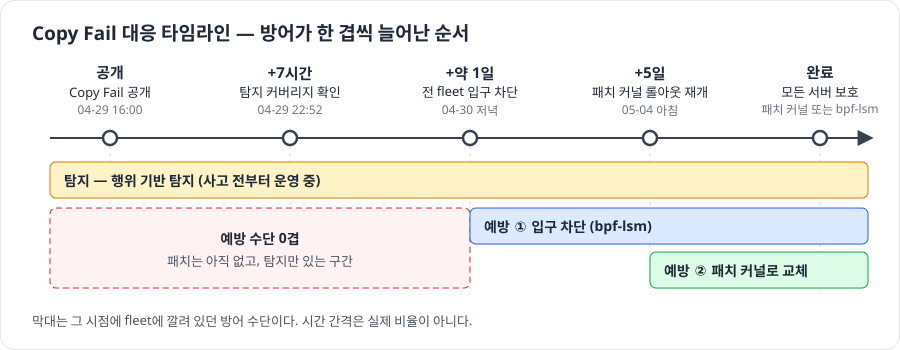
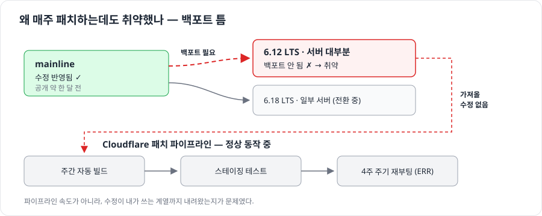
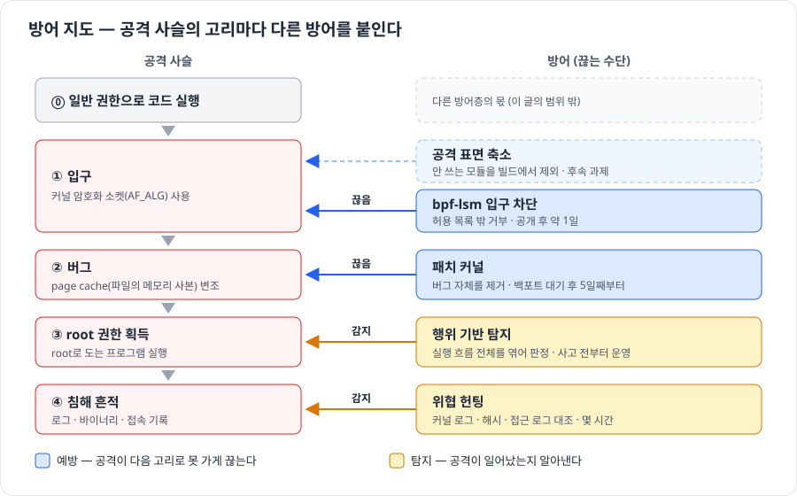
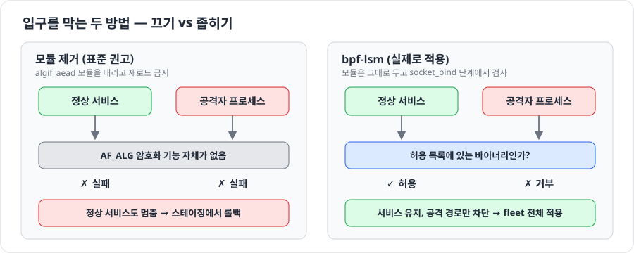
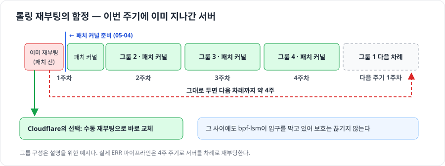

# Copy Fail 커널 취약점 대응 - 패치된 커널이 오기 전 재부팅 없이 fleet을 막는 법

## 출처

- **아티클**: How Cloudflare responded to the "Copy Fail" Linux vulnerability
- **저자/출처**: Chris J Arges, Sourov Zaman, Rian Islam, Cloudflare 블로그, 2026-05-07
- **링크**: https://blog.cloudflare.com/copy-fail-linux-vulnerability-mitigation/

> 원문에 없는 내용은 **(보충)**으로 표시했다. 보충 사실(발견 경위, 커널 보안팀 보고 시점)은 [Wikipedia - Copy Fail](https://en.wikipedia.org/wiki/Copy_Fail)에서 가져왔다.
>
> 그림은 원문 내용을 바탕으로 직접 그린 것이다(`images/`). PoC는 만들지 않았고, 문서의 명령어도 직접 실행해 확인하지 않았다.

---

## AI 요약

### 0. 한 장 요약



> **패치가 아직 없을 때의 방어 순서**
> 1. 이미 뚫렸는지부터 확인한다 (탐지·위협 헌팅)
> 2. 취약한 입구만 막는다 (bpf-lsm: 재부팅 없이 커널 동작을 허용·거부하는 보안 프로그램)
> 3. 패치 커널은 평소 재부팅 자동화로 넣는다

| 공개(04-29 16:00) 기준 | 결과 |
| --- | --- |
| +7시간 | 기존 탐지로 잡히는 것 확인 |
| +약 1일 | fleet 전체 입구 차단 |
| +5일 | 패치 커널 롤아웃 재개 |
| 고객 영향 | 없음 |

### 1. Copy Fail이란

**리눅스 커널 버그(CVE-2026-31431)다. 일반 사용자 권한으로 코드를 실행할 수 있으면 root 권한을 얻을 수 있다.**

| 용어 | 뜻 |
| --- | --- |
| page cache | 커널이 파일 내용을 메모리에 올려 둔 사본. 프로그램을 실행하면 여기서 읽는다 |
| AF_ALG | 일반 프로그램이 커널 암호화 기능을 쓰게 해 주는 소켓. 권한 없이 쓸 수 있다 |
| setuid-root | 누가 실행하든 root 권한으로 도는 프로그램 (`/usr/bin/su` 등) |

- **원인**: 2017년 커널 암호화 모듈(`algif_aead`)에 들어간 최적화가 정해진 범위 밖에 4바이트를 쓰는 것을 막지 못했다.
- **결과**: 쓰기 권한이 없는 파일의 page cache를 바꿀 수 있다. setuid-root 프로그램의 사본을 바꾸면 root 권한을 얻는다. 디스크의 원본 파일은 그대로다.
- **영향 범위**: 2017년 이후 거의 모든 리눅스 배포판
- **수정**: upstream 패치(커밋 `a664bf3d603d`)가 2017년 최적화를 되돌렸다.
- (보충) Theori의 연구원이 AI 기반 분석의 도움으로 찾았고, 공개 5주 전에 커널 보안팀에 보고했다.

### 2. 왜 매주 패치하는 회사가 취약했나 — 백포트 틈



- **평소 전제**: CVE가 공개될 때쯤이면 수정은 이미 몇 주 전에 stable LTS에 들어가 있고, 파이프라인이 그 사이 배포를 끝낸다.
- **이번에 깨진 점**: 수정은 한 달 전에 mainline(최신 개발 브랜치)에 들어갔지만, 서버 대부분이 쓰는 **6.12 LTS로는 백포트(옮겨 적용)되지 않았다.**
- 파이프라인은 정상으로 돌고 있었다. **가져올 수정이 없었을 뿐이다.**

> "몇 버전에서 고쳐졌다"와 "내가 쓰는 계열에 수정이 들어왔다"는 다르다.

<sub>원문 결론부에는 "2주마다 패치 배포"라는 표현도 있다. 이 문서는 배경 절의 설명(주간 빌드, 4주 재부팅 주기)을 따랐다.</sub>

### 3. 방어 전략 — 공격 사슬의 고리마다 다른 방어를 붙인다



공격은 여러 단계(고리)로 이어진다. 고리 하나만 끊어도 공격은 끝까지 가지 못한다.

**핵심은 가장 근본적인 방어가 가장 느리다는 점이다.** 패치 커널은 백포트를 기다린 뒤 수십만 대를 재부팅해야 한다. 그래서 순서가 이렇게 정해졌다.

| 순서 | 할 일 | 이유 |
| --- | --- | --- |
| 1 | 이미 뚫렸는지 확인 (탐지·헌팅) | 이미 root를 땄다면 입구를 막아도 소용없다 |
| 2 | 입구만 막기 (bpf-lsm) | 버그를 고치지 않아도 하루 안에 끊을 수 있는 고리다 |
| 3 | 근본 수정 (패치 커널) | 가장 확실하지만 가장 느리다 |

### 4. 먼저 확인 — 이미 뚫렸나

> **아니라는 걸 증명하기 전까지는 침해당했다고 가정한다.**

**탐지.** 서버에는 프로세스 실행 흐름의 이상을 보는 **행위 기반 탐지**가 이미 돌고 있었다. Copy Fail 전용 룰 없이도 내부 검증에서 몇 분 만에 exploit을 잡았다. 공개 약 7시간 만에 "탐지는 된다"를 확인했다.

| | 시그니처 기반 | 행위 기반 |
| --- | --- | --- |
| 보는 것 | 알려진 공격의 고유 패턴 | 비정상적인 실행 흐름 |
| 새 취약점이 나오면 | 룰을 새로 써야 한다 | 결과(갑작스런 권한 상승)가 비슷하면 그대로 잡는다 |

**위협 헌팅.** 공개 전에 이미 악용됐는지 네 가지를 확인했다. 결과는 모두 깨끗했다.

| 확인 항목 | 방법 |
| --- | --- |
| 실행 흔적 | exploit이 커널 로그에 남기는 흔적을 공개 전 48시간치 중앙 로그에서 검색 |
| 접속 이력 | 접근 로그로 누가, 언제, 무엇을 실행했는지 재구성 |
| 바이너리 변조 | 시스템 바이너리 해시를 패키지 매니페스트의 정상값과 대조 |
| 지속성·네트워크 | 백도어 같은 지속성 장치와 비정상 네트워크 연결 점검 |

### 5. 입구만 막기 — bpf-lsm



**첫 시도는 실패했다.** 발견자들이 권고한 대로 `algif_aead` 모듈을 내렸더니, 커널 암호화 기능을 정상적으로 쓰는 내부 서비스까지 막혔다. 스테이징에서 발견해 롤백했고 프로덕션 영향은 없었다.

**두 번째는 bpf-lsm이다.** LSM(Linux Security Module)은 커널이 소켓 bind 같은 동작을 하기 직전에 거치는 보안 검사 지점이다. 여기에 eBPF 프로그램을 붙여 재부팅 없이 규칙을 추가했다.

```text
socket_bind 호출마다:
  AF_ALG가 아님                → 허용
  AF_ALG + 허용 목록의 바이너리 → 허용 (정상 서비스)
  AF_ALG + 그 밖의 바이너리     → 거부 (공격 경로 차단)
```

**배포는 두 단계로 나눴다.** 허용 목록이 틀리면 서비스가 죽기 때문이다.

| 단계 | 한 일 | 결과 |
| --- | --- | --- |
| 1. 가시성 | eBPF로 바이너리별 AF_ALG 사용량을 fleet 전체에서 집계 | 수십만 대 집계가 몇 시간 만에 나옴. 정상 사용자는 서비스 하나 |
| 2. 차단 | bpf-lsm을 **별도 게이트**로 배포 | 문제가 생기면 차단만 바로 끌 수 있음 |

- (보충) BPF LSM은 커널이 `CONFIG_BPF_LSM`으로 빌드돼 있고 부팅 때 활성 LSM 목록에 `bpf`가 들어 있어야 쓸 수 있다. **재부팅 없는 완화도 사고 전 준비가 필요하다.**
- **한계**: bpf-lsm은 버그를 고친 게 아니라 입구를 좁힌 것이다. 그래서 패치 커널은 여전히 필요하다.

<details>
<summary>완화됐는지 확인하는 방법 (공격 없이 bind만 시도)</summary>

```bash
python3 -c 'import socket; s = socket.socket(socket.AF_ALG, socket.SOCK_SEQPACKET, 0); s.bind(("aead","authencesn(hmac(sha256),cbc(aes))"));'
```

- 완화 전: 출력 없이 끝난다 (bind 성공)
- 완화 후: `PermissionError: [Errno 1] Operation not permitted` (완화 방식에 따라 `FileNotFoundError`)

</details>

### 6. 근본 수정 — 서두르지 않은 패치 롤아웃

04-30 오후의 결정은 다음과 같다.

| 선택지 | 결정 |
| --- | --- |
| 쓰던 계열(6.12)의 패치 빌드를 평소 재부팅 자동화로 배포 | ✅ |
| 새 계열(6.18)로 전환을 앞당기기 | ❌ |
| 그 사이 bpf-lsm으로 버티기 | ✅ |

원문은 이유를 따로 밝히지 않았다. 커널 계열을 바꾸면 수정 외에도 많은 변경이 한꺼번에 들어오고, 입구가 이미 막혀 있으니 서두를 이유가 없었던 것으로 읽힌다. (내 해석)

백포트가 나오자 패치 커널을 빌드하고 스테이징 테스트를 거쳐, **05-04부터 재부팅 자동화를 정상 속도로 재개**했다.



**함정**: 그 주에 이미 재부팅을 마친 서버는 패치 전 커널로 올라와 있어서, 다음 차례까지 약 4주를 기다려야 한다. Cloudflare는 이 서버들을 수동으로 다시 재부팅했다.

> **끝난 상태: 모든 서버가 "패치 커널 또는 bpf-lsm" 중 하나로 보호됐다.** 전환 기간 내내 보호가 0겹인 서버가 없었다.

### 7. 평소 준비가 대응 속도를 정한다

사고 중에 새로 만든 것은 AF_ALG 차단 규칙과 관찰 설정 정도다. 나머지는 사고 전부터 있었다.

| 사고 전에 있던 것 | 사고 때 가능해진 것 |
| --- | --- |
| 행위 기반 탐지 | 전용 룰 없이 7시간 만에 탐지 확인 |
| 중앙 로그 수집 | 공개 전 48시간 위협 헌팅 |
| bpf-lsm 도구 + BPF LSM이 켜진 커널 (보충) | 규칙 작성부터 fleet 적용까지 약 하루 |
| eBPF 관찰 도구, 배포 게이트 | 수십만 대의 사용자를 몇 시간 만에 집계 |
| 스테이징 데이터센터 | 모듈 제거 실패를 프로덕션 전에 발견 |
| 재부팅 자동화 (ERR, 4주 주기) | 백포트가 오자 정상 속도로 롤아웃 |

**Cloudflare가 꼽은 후속 과제 세 가지**

1. **커널 API 의존성 가시화**: 어떤 서비스가 어떤 커널 기능을 쓰는지 미리 파악한다. 이번에 모듈 제거가 실패한 원인이다.
2. **런타임 완화 도구 개선**: bpf-lsm의 배포 속도, 플레이북, 로깅을 개선한다.
3. **커널 공격 표면 축소**: 쓰지 않는 모듈과 기능을 빌드에서 아예 뺀다.

<details>
<summary>상세 타임라인 (UTC)</summary>

| 시각 | 일 |
| --- | --- |
| 04-29 16:00 | Copy Fail 공개 |
| 04-29 ~21:00 | 노출 범위와 완화책 검토 시작 |
| 04-29 22:52 | 기존 행위 기반 탐지가 exploit 패턴을 잡는 것 확인 |
| 04-29 23:01 | 탐지가 high-severity 알림 생성 |
| 04-29 저녁 | 모듈 제거를 스테이징에 배포 → 의존성 충돌 → 롤백 |
| 04-29 밤 | bpf-lsm 규칙 초안 작성 |
| 04-30 03:14 | 보안 사고 선언, fleet 전체 위협 헌팅 |
| 04-30 오전 | bpf-lsm 테스트, 프로덕션 준비 완료 |
| 04-30 14:25 | 엔지니어링 사고 선언 |
| 04-30 ~17:00 | 결정: 쓰던 LTS의 패치 빌드로, 새 LTS는 앞당기지 않음 |
| 04-30 오후 | AF_ALG 사용 현황 eBPF 추적 배포 |
| 04-30 저녁 | bpf-lsm fleet 전체 적용, 테스트 노드에서 차단 확인 |
| 05-04 오전 | 패치 커널로 재부팅 자동화 재개 |
| 05-04 이후 | 이미 재부팅한 서버는 수동 재부팅 |

</details>

---

## 내가 얻은 인사이트

1. **"몇 버전에서 고쳐졌나"보다 "내 계열에 백포트됐나"를 본다**
   - 위험은 파이프라인 속도가 아니라 백포트 지연에 있었다. CVE를 볼 때 내가 쓰는 LTS·배포판 커널에 수정이 들어왔는지까지 확인해야 한다.

2. **완화책도 배포다**
   - 표준 권고를 그대로 프로덕션에 뿌렸다면 장애가 났다. 긴급할수록 스테이징과 "가시성 → 차단" 순서를 지킨다.

3. **완화가 있으면 근본 수정을 서두르지 않아도 된다**
   - 입구를 막아 둔 덕에 새 LTS 전환이나 무리한 재부팅 없이 정상 속도로 패치했다. 지켜야 할 불변 조건은 "보호가 0겹인 서버가 없을 것"이다.

4. **입구가 좁아서 통한 방법이다** (내 해석)
   - 입구가 AF_ALG bind 하나이고 정상 사용자가 하나였기에 bpf-lsm이 통했다. 모든 프로세스가 지나가는 경로의 버그는 이렇게 막을 수 없다.
   - 그래서 가장 넓게 통하는 방어는 **쓰지 않는 커널 기능을 미리 빌드에서 빼는 것**이다. [NCSC 패치 웨이브 문서](../AI%20시대%20서버%28OS%29%20보안%20전략%20-%20취약점%20패치%20웨이브에%20대비하는%20법%20%28NCSC%29.md)의 "노출면 축소"가 커널 안에서는 이런 모습이 된다.

5. **헌팅 범위는 로그 보존 기간이 정한다** (내 해석)
   - 헌팅은 공개 전 48시간을 봤지만, 버그는 5주 전에 보고됐다(보충). AI가 같은 결함을 여러 곳에서 찾을 수 있는 시대라면 로그 보존 기간을 정할 때 이 점도 따져야 한다.
