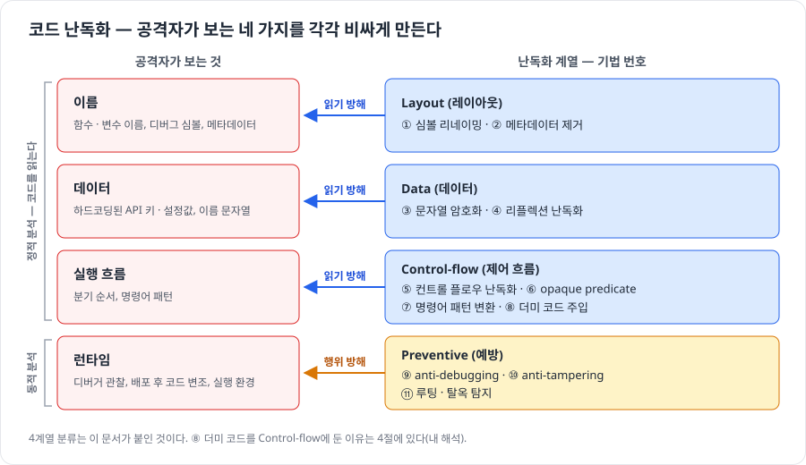
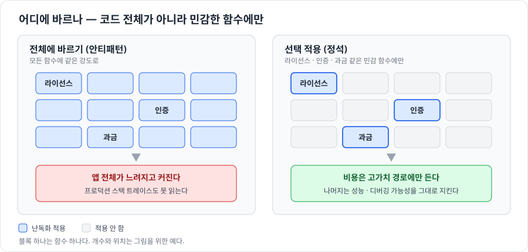
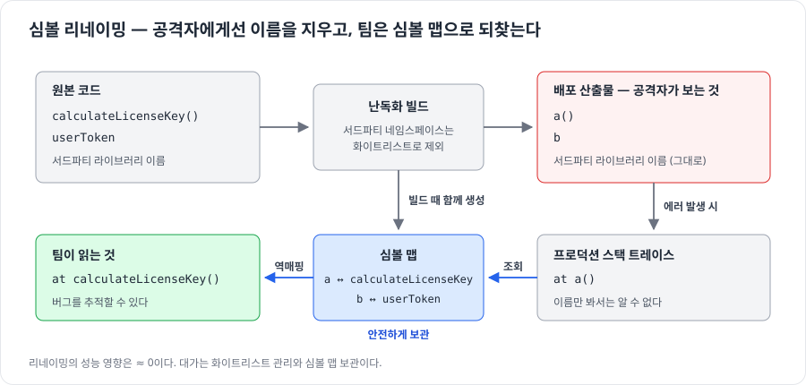
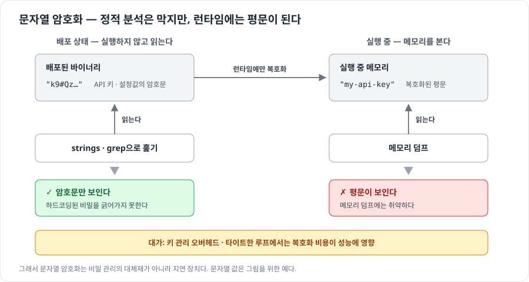
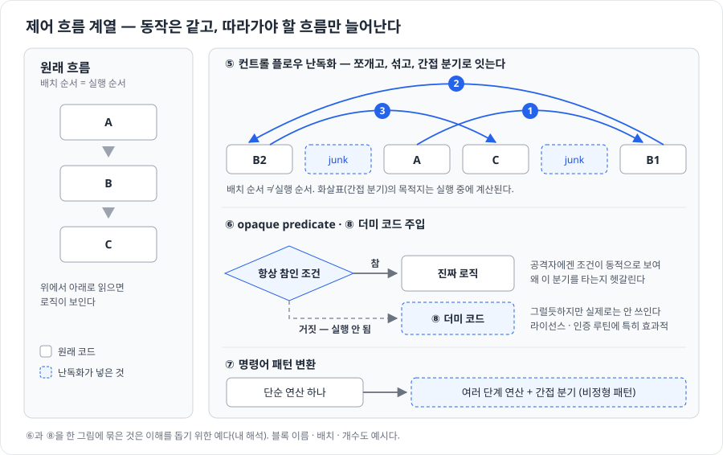
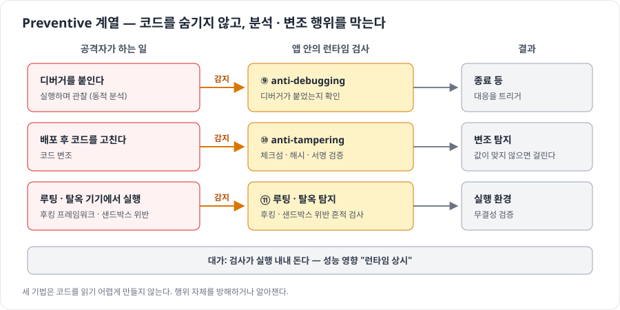

# 코드 난독화 기법 11가지 - 리버스 엔지니어링 방어의 도구 상자

## 출처
- **아티클/논문**: 11 Code Obfuscation Techniques for Application Protection
- **저자/출처**: PreEmptive (Blog)
- **링크**: https://www.preemptive.com/blog/code-obfuscation-techniques/

> 그림은 원문 내용을 바탕으로 직접 그린 것이다(`images/`).

---

## AI 요약

### 0. 한 장 요약

> **난독화는 리버스 엔지니어링을 "불가능"하게 만드는 게 아니라 "비용에 안 맞게" 만든다.**
> 1. 공격자가 보는 네 가지(이름 · 데이터 · 실행 흐름 · 런타임)마다 다른 계열의 기법이 붙는다
> 2. 앞의 세 계열은 코드를 **읽는** 비용을, Preventive는 실행하며 **분석 · 변조하는** 비용을 올린다
> 3. 성능 · 디버깅 가능성을 내주므로 민감한 함수(라이선스 · 인증 · 과금)에만 바른다

| 계열 | 건드리는 것 | 기법 (11가지) | 절 |
| --- | --- | --- | --- |
| **Layout** (레이아웃) | 이름 · 메타데이터 | ① 심볼 리네이밍 ② 메타데이터 제거 | 2절 |
| **Data** (데이터) | 상수 · 문자열 | ③ 문자열 암호화 ④ 리플렉션 난독화 | 3절 |
| **Control-flow** (제어 흐름) | 실행 순서 · 분기 | ⑤ 컨트롤 플로우 난독화 ⑥ opaque predicate ⑦ 명령어 패턴 변환 ⑧ 더미 코드 주입 | 4절 |
| **Preventive** (예방) | 런타임 상태 | ⑨ anti-debugging ⑩ anti-tampering ⑪ 루팅/탈옥 탐지 | 5절 |

계열 분류와 번호 순서는 이 문서가 정리한 것이다. ⑧을 Control-flow에 둔 이유는 4절에 있다.

| 용어 | 뜻 |
| --- | --- |
| 리버스 엔지니어링 | 배포된 프로그램을 거꾸로 분석해 동작과 설계를 알아내는 일 |
| 정적 분석 | 실행하지 않고 코드 · 바이너리를 읽는 분석 (`strings`, grep 등) |
| 동적 분석 | 실행하면서 관찰하는 분석 (디버거 등) |

### 1. 난독화란 — 동작은 그대로, 이해 비용만 올린다

**코드 난독화(Code Obfuscation)**는 프로그램의 동작은 그대로 두고, 코드를 사람(과 자동 분석 도구)이 이해하기 어렵게 바꾸는 기법이다.

- 난독화는 **성능 · 디버깅 가능성과 트레이드오프**다.
- 그래서 전체 코드베이스에 바르지 않고 **민감한 함수(라이선스 · 인증 · 과금)에만 선택 적용**하는 것이 정석이다.

> 목표는 "못 뚫게"가 아니라 "뚫기 비싸게"다. 비용은 지킬 가치가 있는 곳에만 쓴다.

### 2. Layout 계열 — 이름과 메타데이터 지우기

| 용어 | 뜻 |
| --- | --- |
| 심볼 | 함수 · 변수 · 클래스의 이름 |
| 메타데이터 | 메서드명 · 디버그 심볼 · 파라미터 타입 · 어노테이션처럼 코드에 붙은 부가 정보 |
| 심볼 맵 | 바뀐 이름과 원래 이름의 대응표 |

| 기법 | 하는 일 | 대가 · 함정 |
| --- | --- | --- |
| **① 심볼 리네이밍** (Symbol Renaming) | `calculateLicenseKey()` → `a()`, `userToken` → `b`처럼 의미 있는 이름을 무의미한 문자열로 바꾼다. 성능 영향 ≈ 0. 가장 기본이자 가성비 최고 | 서드파티 라이브러리 심볼까지 무분별하게 바꾸면 앱이 깨진다 → 특정 네임스페이스를 **화이트리스트**로 제외한다. 디버깅을 위해 **심볼 맵**을 안전하게 보관한다 |
| **② 메타데이터 제거** (Metadata Stripping) | 메서드명 · 디버그 심볼 · 파라미터 타입 · 스택 트레이스 · 어노테이션을 컴파일 산출물에서 지운다 | 프로덕션 버그 추적이 어려워진다. 메타데이터에 의존하는 직렬화 도구와 충돌할 수 있다 |

> 이름을 지우는 건 거의 공짜다. 비용은 우리 팀의 디버깅에서 나오고, 심볼 맵이 그 비용을 갚는다.

### 3. Data 계열 — 상수와 문자열 숨기기

| 용어 | 뜻 |
| --- | --- |
| 리플렉션 | 클래스 · 메서드를 이름 문자열로 찾아 실행 중에 호출하는 기능 |

| 기법 | 하는 일 | 대가 · 함정 |
| --- | --- | --- |
| **③ 문자열 암호화** (String Encryption) | API 키 · 설정값 같은 하드코딩 데이터를 암호화해 두고 **런타임에만 복호화**한다. 정적 분석(`strings`, grep)으로 비밀을 긁어가는 것을 막는다 | 키 관리 오버헤드가 생긴다. 타이트한 루프에서는 복호화 비용이 성능에 영향을 준다. 런타임엔 결국 평문이 되므로 **메모리 덤프에는 취약**하다 |
| **④ 리플렉션 난독화** (Reflection Obfuscation) | 클래스 · 메서드를 이름 문자열이 아니라 **커스텀 로더/디코더로 동적 해석**한다. 사람이 읽는 이름을 암호화 문자열로 대체한다 | – |

`–`: 따로 정리된 함정이 없다.

> 문자열 암호화는 정적 분석을 막는 지연 장치다. 런타임의 평문까지 지키지는 못한다.

### 4. Control-flow 계열 — 실행 흐름 흐트러뜨리기

| 용어 | 뜻 |
| --- | --- |
| junk code | 결과에 영향을 주지 않는 의미 없는 코드 |
| 간접 분기 (indirect branching) | 점프할 위치가 코드에 고정되지 않고 실행 중에 계산되는 분기 |
| opaque predicate (불투명 술어) | 결과는 항상 같지만 겉으로는 동적으로 보이는 조건문 |

| 기법 | 하는 일 | 대가 · 함정 |
| --- | --- | --- |
| **⑤ 컨트롤 플로우 난독화** (Control Flow Obfuscation) | 선형적인 코드 흐름을 잘게 쪼개 재배열하고, **junk code 삽입 + 간접 분기**로 실제 로직을 감춘다. 동작은 같고 흐름 파악만 어려워진다 | 잘못 적용하면 앱이 눈에 띄게 느려진다. 디버깅이 크게 어려워지고 정적 분석기가 아예 실패하기도 한다 → 민감 함수에만 |
| **⑥ Opaque Predicate** | 항상 `true`(또는 항상 `false`)로 귀결되지만 공격자에겐 동적으로 보이는 조건문을 넣어, **왜 이 분기를 타는지** 헷갈리게 한다 | 개당 비용은 작지만 다수 삽입 시 누적 성능 저하. 보안 스캐너가 false positive를 낼 수 있다 |
| **⑦ 명령어 패턴 변환** (Instruction Pattern Transformation) | 컴파일러가 만드는 예측 가능한 명령어 패턴을 비정형적으로 재작성한다. 단순 연산을 여러 단계로 쪼개고 간접 분기를 섞는다 | 유지보수성 · 표준 도구 호환성 저하 → 보통 **프로덕션 빌드 전용** |
| **⑧ 더미 코드 주입** (Dummy Code Injection) | 실제로는 안 쓰이지만 그럴듯한 코드를 넣어 공격자를 교란한다. 라이선스 · 인증 루틴에 특히 효과적 | 바이너리 크기 증가, 성능 병목 가능. 보안 도구가 의심 코드로 오탐할 수 있다 |

- (내 해석) ⑧은 실행 중에 무언가를 검사하지 않는다. 읽어야 할 코드를 늘려 교란하는 기법이라 이 문서는 Preventive가 아니라 Control-flow 계열에 둔다.

> 동작은 그대로 두고, 읽는 사람이 따라가야 할 경로만 늘린다. 대가는 성능과 디버깅이다.

### 5. Preventive 계열 — 런타임 방어

| 용어 | 뜻 |
| --- | --- |
| 후킹 (hooking) | 실행 중인 함수 호출을 가로채 동작을 바꾸는 것 |
| 루팅 / 탈옥 | 모바일 OS의 권한 제한을 풀어 관리자 권한을 얻은 상태 |

| 기법 | 하는 일 |
| --- | --- |
| **⑨ Anti-Debugging** | 디버거가 붙으면 종료 등 대응을 트리거한다 |
| **⑩ Anti-Tampering** | 체크섬 · 해시 · 서명 검증으로 배포 후 코드 변조를 탐지한다 |
| **⑪ 루팅/탈옥 탐지** (Root/Jailbreak Detection) | 후킹 프레임워크 · 샌드박스 위반 흔적을 런타임에 검사해 실행 환경의 무결성을 검증한다 |

> 이 계열은 "코드를 못 읽게"가 아니라 **"분석 · 변조 행위 자체를 방해"**하는 런타임 방어다.

### 6. 한눈에 보는 비교 — 성능 영향과 방어 대상

| 기법 | 성능 영향 | 주 방어 대상 |
| --- | :---: | --- |
| 심볼 리네이밍 | 없음 | 정적 이해 |
| 문자열 암호화 | 낮음(루프 주의) | 비밀 추출 |
| 컨트롤 플로우 난독화 | 중~높음 | 로직 파악 |
| Opaque predicate | 낮음(누적 주의) | 분기 이해 |
| Anti-debug/tamper | 런타임 상시 | 동적 분석 · 변조 |

> 이 표에서 성능 영향이 "없음"인 기법은 심볼 리네이밍뿐이다. 나머지는 비용을 치르고 쓴다.

---

## 내가 얻은 인사이트

1. **난독화는 단일 스위치가 아니라 층의 조합이다**
   - 기법마다 막는 위협(정적 이해 / 비밀 추출 / 흐름 파악 / 변조)이 다르다. 정적 분석이 막히면 리버스 엔지니어는 디버거를 붙이므로, 읽기 방해(Layout · Data · Control-flow)와 행위 방해(Preventive) **두 축을 모두** 쌓아야 실효가 있다.

2. **문자열 암호화는 비밀 관리의 대체재가 아니라 지연 장치다**
   - 런타임엔 결국 평문이 되므로 메모리 덤프엔 무력하다. 진짜 비밀은 서버로.

3. **전면 적용은 안티패턴 — 고가치 경로에만 바른다**
   - 컨트롤 플로우 난독화 · 더미 코드는 성능과 바이너리 크기를 갉아먹는다. 라이선스 · 인증 · 과금 같은 고가치 경로에만 집중하는 게 비용 대비 효과가 크다.

4. **디버깅 파이프라인과 오탐 대응을 먼저 준비한다**
   - 심볼 맵의 안전한 보관 · 역매핑 체계가 없으면 난독화가 우리 팀의 생산성을 먼저 죽인다. opaque predicate · 더미 코드는 보안 스캐너 · 백신이 의심 코드로 플래그할 수 있으니 배포 전 **AV 벤더 화이트리스트 · 코드 서명**을 함께 준비한다.

5. **성공 지표는 "못 뚫린다"가 아니라 "뚫는 비용 > 얻는 가치"다**
   - 이 11가지는 언어 · 플랫폼 불문의 공통 도구 상자다. Electron의 V8 바이트코드, .NET의 Dotfuscator, Android의 R8/ProGuard 모두 이 중 일부를 구현한 것이다. 방어 설계를 이 손익분기로 환원하면 어떤 기법을 몇 겹 쌓을지가 명확해진다.
